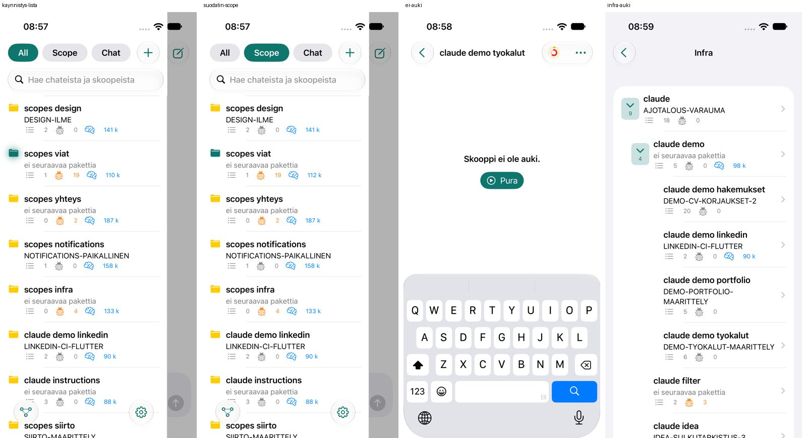
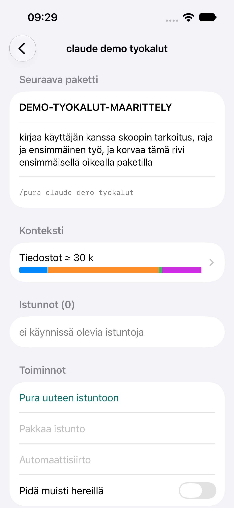
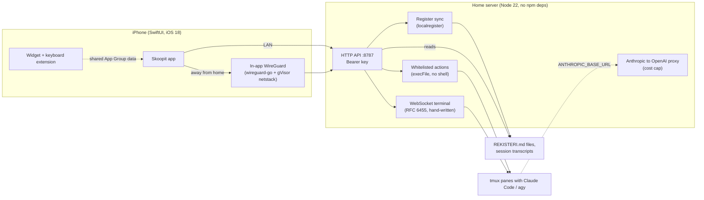

# Scopes v1 (Skoopit)

[](https://github.com/Rolppe/scopes_v1/actions/workflows/ci.yml)

An iPhone app and a home-server service for monitoring and steering dozens of parallel Claude Code sessions that run in tmux.

The app shows each "scope" (a named work area with its own register file), how large the context of its running
session is, the usage limits, and which sessions are waiting for an answer. From the phone you can unpack, compact and
message sessions. It was built for one user (the author) on a home network. Everything runs on hardware the author owns: a
Node 22 server with no npm dependencies, and an iOS app that carries its own WireGuard tunnel.

This is the first-generation system. Its successor is [scopes_v2](https://github.com/Rolppe/scopes_v2).

## What it does

- Lists every scope with its next work packet, open items, open defects and the measured context size (in tokens) of
  the running Claude Code session. Dark and light themes, landscape layout, a lock-screen widget.
- Shows the 5-hour and weekly Claude usage limits, and a context breakdown per register file.
- Controls sessions through a fixed set of actions: unpack a scope into a new tmux session, compact it, queue
  automatic hand-over, create or archive a scope, switch model and effort.
- Chat and per-scope messaging: sends text and attachments to a session's tmux pane, streams answers token by token
  (NDJSON), and renders open multiple-choice questions as cards that can be answered or dismissed.
- Notifies about "session waits for you", "packet ready", "context near limit" and "new open defect" without Apple's
  push service (local notifications plus iOS background refresh).
- Reaches the server from outside the home network through a WireGuard tunnel that lives inside the app process.
- Syncs the Markdown registers between devices at line level, so the phone can edit them.
- Extras: a Finnish keyboard extension, a remote terminal over WebSocket, wake and power-off buttons for the
  server PC, adb control of an Android phone, a macOS client.

## Visual




The UI text is Finnish. First image, left to right: the scope list with its All / Scope / Chat filter, the Scope
filter, a scope without a running session (with a Pura, "unpack", button), and the Infra tree. Second image: a scope
detail view with next work packet, file context bar, sessions and actions.



## Engineering highlights

- **VPN inside the app, no Network Extension.** A free Apple account cannot use Network Extensions, so the app embeds
  `wireguard-go` with gVisor's userspace TCP/IP stack through gomobile and exposes the tunnel as a local port.
  `Reitti` probes `/api/terveys` with a 1.5 s timeout, goes direct at home and through the tunnel elsewhere, fetches
  the tunnel config from the server while at home and stores it in the Keychain, and reopens the listener when iOS
  has reclaimed the socket of a frozen app. Files: [ios/tunneli/tunneli.go](ios/tunneli/tunneli.go),
  [ios/Sources/Reitti.swift](ios/Sources/Reitti.swift).
- **Register sync with fractional indexing and version vectors.** Markdown registers are split into one unit per
  line. Each unit has a string order key that always has room between two neighbours (`valiin`), a per-device version
  vector, and tombstones for deletes. Concurrent edits are detected, kept side by side and put to the user. The
  design was driven by a measurement of 859 historical register edits ([localregister/MUOTO.md](localregister/MUOTO.md)).
  The same algorithm exists in JavaScript ([localregister/lr.mjs](localregister/lr.mjs)) and Swift
  ([ios/Sources/Lr.swift](ios/Sources/Lr.swift)), and a round-trip check (`lr.mjs testaa`) verifies that the split is lossless.
- **Streaming that survives disconnects.** A phone locks its screen mid-answer. The server keeps generating, buffers the
  text, and `GET /api/chat/kaynnissa` lets the client rejoin: it gets the text so far in one piece, then the rest.
  A finished run stays joinable for 10 minutes. See `kasittelija` in [palvelu/palvelin.mjs](palvelu/palvelin.mjs).
- **Hand-written RFC 6455 WebSocket with a 1-byte channel frame.** `'0'` raw terminal data, `'1'` JSON control (resize,
  signal), `'2'` heartbeat. No JSON overhead on the data path, no `ws` package. Server:
  [palvelu/terminal.mjs](palvelu/terminal.mjs); contract: [remoteterminal/RAJAPINTA.md](remoteterminal/RAJAPINTA.md).
- **"Only ready-made actions" security model.** The phone can never send a command, flag or free text to a command
  line. Actions are a closed list, names are checked against a strict pattern or the scope list, commands run through
  `execFile` without a shell, one action runs at a time (429 otherwise), every attempt including rejected ones is
  logged, and the Bearer key is compared in constant time (`timingSafeEqual`). The server refuses to start with a key
  shorter than 32 characters. [palvelu/toiminnot.mjs](palvelu/toiminnot.mjs), `avainKelpaa` in `palvelin.mjs`.
- **Anthropic to OpenAI translation proxy with a fail-closed cost cap.** Lets Claude Code run against a provider that
  speaks only `/v1/chat/completions`, including streaming and tool calls. Before every call it computes spend from a
  token log at the provider's own prices plus a worst-case estimate for the new call; a missing or unreadable cap
  means no call at all (written after an uncapped measurement run cost about 7.10 USD).
  [palvelu/nebius-valitys.mjs](palvelu/nebius-valitys.mjs).
- **Schemaless protobuf decoding.** The Antigravity CLI (`agy`) keeps conversations as protobuf blobs in SQLite without
  a published schema. A small varint/length-delimited reader plus field numbers found empirically on one CLI version
  turn them into chat messages; unknown structure yields fewer messages, never an error.
  [palvelu/agy-istunto.mjs](palvelu/agy-istunto.mjs) (22 tests).
- **Freeze diagnostics, background refresh and a measured UI fix.** The server logs every request and any event-loop
  stall over 500 ms; the app posts main-thread hangs and MetricKit reports back ([palvelu/diagnostiikka.mjs](palvelu/diagnostiikka.mjs)).
  Notifications use `BGAppRefreshTask` because APNs is unavailable ([ios/Sources/Ilmoitukset.swift](ios/Sources/Ilmoitukset.swift)).
  Sidebar drag jank was fixed by making the main content an `Equatable` view; frames drawn per drag went from 7-13 to
  19-24 and the longest frame from 65-85 ms to 33-57 ms in six simulator runs per variant
  ([performance/ios/MITTAUKSET-2026-10-18.md](performance/ios/MITTAUKSET-2026-10-18.md)).

## Tech stack

| Layer | Technology | Version |
|---|---|---|
| iOS app | SwiftUI, XcodeGen project, WidgetKit, keyboard extension | iOS 18.0 target, Xcode 26 |
| Shared Swift | `ScopesCore`, `ScopesUI` Swift packages (iOS and macOS clients) | tools 5.9, iOS 17 / macOS 14 |
| Tunnel | Go, wireguard-go, gVisor netstack, gomobile | Go 1.26 |
| Server | Node.js, built-ins only (`node:http`, `node:sqlite`, `node:test`) | Node 22 |
| Sessions | tmux, Claude Code, agy | n/a |
| Remote terminal client | SwiftTerm Swift package | 1.0.0 or later |
| Tests | XCUITest, XCTest, `node:test`, `go test` | n/a |

## Architecture

The phone talks HTTP and NDJSON to one Node process on the home server. That process reads the register files and
Claude Code transcripts to build the scope view, and acts on sessions only by typing into tmux panes through a closed
list of actions. Away from home the same HTTP traffic goes through the in-app WireGuard tunnel. Registers are synced
through a separate line-level store that is exported back to git. Details, invariants and design decisions are in
[ARCHITECTURE.md](ARCHITECTURE.md).

## Repository layout

```
ios/            Skoopit app (SwiftUI), widget, keyboard extension, UI tests, tunneli/ (Go tunnel)
palvelu/        Node server: palvelin.mjs (HTTP API), actions, chat, terminal, proxy, agy, android
localregister/  Register sync: lr.mjs (store), palvelu.mjs (HTTP routes), MUOTO.md (format)
shared/         ScopesCore and ScopesUI Swift packages (shared by iOS and macOS)
macos/          ScopesMac client (XcodeGen project, SwiftUI)
remoteterminal/ Remote terminal: Swift package (SwiftTerm), protocol contract, gate script
ioskeyboard/    Identical copy of ios/Keyboard plus its working notes
siirto/ agy/    Session hand-over helpers (git, economy), Antigravity CLI integration
design/         Look and feel notes and the screenshots used above
performance/    Measurements
toteutussuunnitelma/ architecture/ ...   Internal plans, briefs and registers (Finnish)
```

About 40 further top-level directories hold the working notes of individual scopes; see [docs/DEVELOPMENT.md](docs/DEVELOPMENT.md).
`ioskeyboard/Sources` and `ios/Keyboard` are identical (`diff -r` reports no difference); the copy was kept as a record.

## Getting started

Prerequisites: a Mac with Xcode 26 and XcodeGen; Go 1.26 (gomobile comes from the `tool` directive in
`ios/tunneli/go.mod`); Node 22 or newer, tmux and Claude Code on the server.

Build the iOS app (simulator, no signing team needed):

```
cd ios/tunneli && ./rakenna.sh          # builds Tunneli.xcframework (needs network for Go modules)
cd .. && xcodegen                       # generates Skoopit.xcodeproj from project.yml
xcodebuild -project Skoopit.xcodeproj -scheme Skoopit \
  -destination "platform=iOS Simulator,id=<UDID from simctl list devices>" CODE_SIGNING_ALLOWED=NO build-for-testing
```

For a device, set `DEVELOPMENT_TEAM` in `ios/project.yml` and replace the `com.example` bundle prefix everywhere
(it is repeated in code for the app group and background task id). The server address and Bearer key are entered in
the app settings; UI tests read `SCOPES_OSOITE` and `SCOPES_AVAIN`.

Run the server: `SCOPES_AVAIN_TIEDOSTO=<file with a key of 32+ chars> node palvelu/palvelin.mjs` (port 8787,
loopback by default, `SCOPES_OSOITE` and `SCOPES_PORTTI` override). `palvelu/kaynnista.sh` is the cron-driven starter
that also creates the key. Without the private monorepo around it the server does not start; see Status.

## Tests

CI (GitHub Actions) runs the standalone Node test set below and the Go tunnel tests on every push.

| Suite | Count | Runs without the monorepo? |
|---|---|---|
| Node (`node:test`), 47 files (static count of `test()` calls) | 534 | 21 files have passing tests; see below |
| Swift packages `shared/ScopesCore`, `shared/ScopesUI` | 22 + 6 | yes, `swift test` in each directory (verified, all pass) |
| `remoteterminal` Swift package | 22 | needs SwiftTerm download; not run |
| XCUITest (`ios/UITests`) | 61 test methods | no: need a Mac simulator and the live server |
| Go (`ios/tunneli`) | 4 | yes; passes in CI (`go test ./...`) |

Verified on Node 26.7: the 16 files that load standalone and fully pass give 106 passing tests:

```
node --test agy/models/mallit.test.mjs palvelu/agy-istunto.test.mjs palvelu/agy-kayttoraja.test.mjs \
  palvelu/agy-luvat.test.mjs palvelu/mac-claude.test.mjs palvelu/nebius-avain.test.mjs \
  palvelu/nebius-valitys.test.mjs palvelu/purkajat.test.mjs siirto/git/*.test.mjs \
  siirto/economy/kuluttajat.test.mjs siirto/economy/task-odotus.test.mjs siirto/economy/claude/*.test.mjs
```

`node --test palvelu/*.test.mjs` gives 58 passing and 11 failing out of 69; the failures are modules that import
`claude/siirto/tools/*.mjs` from the monorepo. With those helper modules stubbed in a scratch copy, the same command
gave 176 of 178 passing (the two failures are stub limitations). Five more files pass partly; the failing tests I
looked at depend on monorepo paths or tools. UI tests use the real service, not mocks, by design.

## How it was built

Mikko Paaso set the requirements, made the architecture decisions and directed the work. Claude Code agents wrote the
code from written briefs and registers, and tests, simulator runs and device runs were the acceptance gates. Mikko
reviewed results and decided what to keep.

- The work was split into feature scopes (chat, list, infra, tunnel, notifications, keyboard ...), each with its own
  session, register (`REKISTERI.md`), history and archive. Decisions are recorded with the date and "Käyttäjä" (user).
- 195 commits between 2026-10-13 and 2026-10-29; 168 carry a `Co-Authored-By` trailer for the model that wrote them
  (Opus 5.5 153, Sonnet 5.5 13, Fable 5.1 2).
- 81 `REKISTERI.md`, 59 `HISTORIA.md` and 59 `ARKISTO.md` files; 82 task briefs in `toteutussuunnitelma/briefit`
  (for the successor, v2) and a log of 47 executor runs (42 green, 4 red, 1 aborted) in
  `toteutussuunnitelma/mittaukset/tehtavat.jsonl`.
- The multi-agent orchestration model (planners, coordinator, watcher, work scopes, escalation rules) is written down in
  [KEHITYSMALLI.md](KEHITYSMALLI.md) (Finnish).

How to read the Finnish working notes: [docs/DEVELOPMENT.md](docs/DEVELOPMENT.md).

## Status and limitations

- Extracted from a private monorepo. `palvelu/` imports three helper modules and calls scripts under
  `claude/siirto/tools` and `Infra/` that are not here, so the server cannot start from this repository alone and 26
  of 47 Node test files have no passing test (25 fail to load).
- Not exercised in this extraction: the Go tests (no network for modules), the XCUITests, the macOS app build, and the
  `remoteterminal` package (it is not linked into the iOS app; its end-to-end verification was still open when
  development stopped). The server side spawns terminal processes over pipes and relies on tmux for a real terminal.
- Free Apple ID signing: 7-day re-signing and no push notifications. The tunnel works only while the app is open.
  Background refresh timing is decided by iOS.
- Transport is plain HTTP with one shared Bearer key (also accepted as `?avain=` for clients that cannot set headers),
  relying on the LAN and WireGuard. The successor replaces this with per-device keys.
- Scripts and docs assume the author's setup (a Mac for builds, a Linux home server, specific tmux session names).
  Internal documents are in Finnish. `lostdev/` holds recovered copies of older files, not live code.
- Superseded by scopes_v2.

## Related repositories

- [scopes_v2](https://github.com/Rolppe/scopes_v2): the successor, with a Rust node embedded in the apps and
  peer-to-peer replication.

## License

AGPL-3.0-only, see [LICENSE](LICENSE). Copyright (c) 2026 Mikko Paaso.
