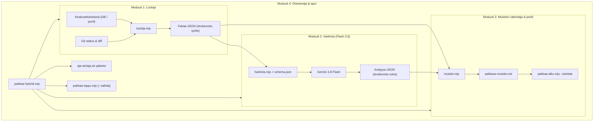

# Hybridi-pakkausscripti (Skripti + Flash 3.8) — Arkkitehtuuri ja rinnakkaistoteutussuunnitelma

Päiväys: 16.10.2026  
Skooppi: `scopes agy siirto pakkausscripti`  
Omistaja: `scopes agy siirto pakkausscripti`  
Tavoite: Kehittää Scopes-ekosysteemiin nopea ja luotettava pakkausscripti, joka jakaa työn deterministisen skriptin ja Gemini 3.8 Flashin välille siten, että toteutustyö voidaan ajaa rinnakkain useilla agenteilla.

---

## 1. Johdanto ja tavoitteet

### Nykytilan haaste
- Claude-keskusteluissa pakkaus perustuu siihen, että suuri päämalli (Opus/Sonnet) lukee koko keskustelun transkriptin, kirjoittaa proosamuotoisen muistion ja ajaa vaiheet 0–3. Tämä on hidasta (tyypillisesti useita minuutteja) ja kuormittaa päämallin kontekstia.
- Puhdas skripti ei yksin kykene ymmärtämään ja tiivistämään keskustelun merkityksellistä sisältöä (mitä tehtiin, arkkitehtuuripäätökset, hukka, seuraava askel).
- Pelkkä pieni kielimalli (Flash 3.8) ilman tiukkaa kehystä voi rikkoa muistion muotoilusääntöjä tai jättää pakollisia lukuja täyttämättä.

### Hybridiratkaisun ydinajatus
Pakkaus jaetaan tarkasti kahteen rooliin:
1. **Deterministinen skripti:** Kerää faktat (git status, diffit, committien otsikot, istunnon viestit), suodattaa kohinan, kutsuu mallia strukturoidulla skeemalla, validoi vastauksen ja suorittaa git-operaatiot ja rekisteripäivitykset.
2. **Gemini 3.8 Flash:** Tekee ainoastaan nopean semanttisen synteesin (muutosten tiivistys, päätösten poiminta, avointen asioiden luokittelu) strukturoituna JSON-datana.

Tuloksena on pakkaus, joka suoriutuu sekunneissa, kuluttaa murto-osan tokeneista ja läpäisee aina tarkistusportit.

---

## 2. Modulaarinen arkkitehtuuri

Järjestelmä pilkotaan viiteen itsenäiseen moduuliin, joilla on selkeät rajapinnat (JSON in / JSON out). Tämä mahdollistaa rinnakkaisen kehityksen ilman koodikonflikteja:



---

## 3. Rinnakkaistoteutuksen työnjako (Agentit 1–5)

Toteutus pystytään ajamaan rinnakkain usealla agentilla seuraavan jaon mukaisesti:

### Agentti 1: Faktalouhija (`scopes/agy/siirto/pakkausscripti/louhija.mjs`)
- **Tehtävä:** Kerätä ja esikäsitellä kaikki faktat istunnosta ja työpuusta:
  * Tmux/istuntotiedot (skooppi, istunnon id, malli, kesto).
  * Viimeisimmät viestit (käyttäjän pyynnöt ja agentin yhteenvedot) SQLite-tietokannasta (`~/.gemini/antigravity-cli/conversations/<id>.db`) ja/tai `transcript.jsonl`:stä.
  * Git-muutokset: muutetut tiedostot (`git status --short`), diffien avaintiedot (`git diff --stat`), uudet commitit.
- **Tuotos:** JSON-olio `Faktat`:
  ```json
  {
    "skooppi": "scopes agy siirto",
    "muutetutTiedostot": ["scopes/agy/siirto/REKISTERI.md"],
    "gitDiffStat": "1 file changed, 10 insertions(+)",
    "kayttajanPyynnot": ["..."],
    "keskusteluTiivistelma": ["..."]
  }
  ```
- **Riippumattomuus:** Ei riipu mallikutsuista; voidaan testata tallennetuilla fixture-tiedostoilla.

### Agentti 2: Flash 3.8 -harkintamoduuli ja skeema (`scopes/agy/siirto/pakkausscripti/harkinta.mjs`)
- **Tehtävä:** Määritellä JSON-skeema ja suorittaa strukturoitu päättely:
  * Määrittelee `schema.json`: kentät `tehty` (array), `todettu` (array), `paatokset` (array), `avoimet` (array of objects {asia, tila, askel}), `viat` (array), `hukka` (string), `kesken` (string), `seuraava` (string).
  * Prompt-malli, joka opastaa Flash 3.8:n noudattamaan Scopes-työtapoja (säännöt 5, 8, 9, 10, 15).
  * Suoritus: ajaa mallikutsun (esim. `agy -p` tai vaihesilmukka/API) ja validoi palautuvan JSON-datan skeemaa vasten.
- **Riippumattomuus:** Voidaan testata itsenäisesti mockatulla `Faktat`-syötteellä.

### Agentti 3: Muistiogeneraattori ja porttivalidoija (`scopes/agy/siirto/pakkausscripti/muistio.mjs`)
- **Tehtävä:** Muuntaa louhijan ja harkinnan tulokset viralliseksi muistioksi:
  * Kirjoittaa `pakkaus-muistio.md`-tiedoston täsmälleen `pakkaa-alku.mjs`:n vaatimaan muotoon.
  * Varmistaa, että yksikään `<!-- TÄYTÄ -->` -kommentti ei jää jäljelle.
  * Validoi tekstin pituuden (< 10 000 merkkiä) ja ajaa `pakkaa-alku.mjs --tarkista` -porttitestin.
  * Korjaa automaattisesti mahdolliset pienet muotopoikkeamat (esim. taulukoiden sarakkeet).
- **Riippumattomuus:** Puhdas datamuunnos- ja tiedostokäsittelykomponentti; testattavissa ilman ulkoisia yhteyksiä.

### Agentti 4: Pääorkestroija ja integraatioajuri (`scopes/agy/siirto/pakkausscripti/pakkaa-hybridi.mjs`)
- **Tehtävä:** Sitoa vaiheet yhtenäiseksi pääohjelmaksi:
  * Vaihe 0–1: Kutsuu `pakkaa-alku.mjs` ja aloittaa louhinnan.
  * Vaihe 2: Ajaa harkinnan ja kirjoittaa muistion.
  * Vaihe 3: Kutsuu `aja-siirtaja.sh paketoi <skooppi>` (rekisteripäivitys).
  * Vaihe 4: Kutsuu `pakkaa-loppu.mjs` lipuilla `-m <viesti> <polut...> --vaihe2 ok --vahvistettu [--vaihda]`.
  * Tulostaa loppuviestin sellaisenaan konsoliin, jotta `agy-istunto.mjs:agyPakattu` aktivoituu.
  * Käsittelee virhe- ja peruutuslogiikan.
- **Riippumattomuus:** Yhdistää moduulit 1–3 ja olemassa olevat siirtotyökalut.

### Agentti 5: Testipatteristo, testidatan generointi ja vertailu (`scopes/agy/siirto/pakkausscripti/pakkausscripti.test.mjs`)
- **Tehtävä:** Rakentaa kattavat automaatiotestit:
  * Fixtuurit erilaisista keskustelutilanteista (uusi skooppi, viankorjaus, laaja refaktorointi, tyhjä istunto).
  * End-to-end-testit kuiva-ajolla (`--kuiva`).
  * Regressiotestaus: varmistaa, että syntyvä muistio ja rekisterimuutokset ovat yhtä laadukkaita tai parempia kuin vanhalla raskaalla menetelmällä.
  * Suorituskykymittaukset (kesto, tokenien kulutus).

---

## 4. Moduulien väliset rajapinnat

### 4.1 Faktat-rajapinta (Moduuli 1 -> Moduuli 2 & 3)
```typescript
interface Faktat {
  skooppi: string;
  istuntoId: string;
  malli: string;
  aloitusAika: string;
  muutetutTiedostot: string[];
  gitDiffStat: string;
  commitit: Array<{ sha: string; viesti: string }>;
  viimeisetViestit: Array<{ rooli: string; teksti: string }>;
  seuraavaHead: string;
  autovalinta: boolean;
  autopack: boolean;
}
```

### 4.2 Analyysi-rajapinta (Moduuli 2 -> Moduuli 3)
```typescript
interface HarkintaAnalyysi {
  tehty: string[];
  todettu: string[];
  paatokset: string[];
  avoimet: Array<{ asia: string; tila: string; askel: string }>;
  viat: string[];
  hukka: string; // esim. "ei — ei havaittu hukkatietoja"
  kesken: string; // esim. "ei — kaikki pyydetty käsitelty"
  seuraavaPaketti: string; // "SEURAAVA PAKETTI: ..."
}
```

---

## 5. Rinnakkaiskehityksen aikataulu ja askeleet

1. **Paketti 1 (Toteutuksen alustus):**
   - Luodaan tiedostopohjat ja rajapintamäärittelyt `scopes/agy/siirto/pakkausscripti/`-hakemistoon.
2. **Paketti 2 (Rinnakkainen moduulitoteutus):**
   - Agentti 1 toteuttaa `louhija.mjs`
   - Agentti 2 toteuttaa `harkinta.mjs` ja `schema.json`
   - Agentti 3 toteuttaa `muistio.mjs`
3. **Paketti 3 (Integraatio ja testaus):**
   - Agentti 4 yhdistää moduulit ajuriksi `pakkaa-hybridi.mjs`
   - Agentti 5 ajaa testipatteriston `pakkausscripti.test.mjs`
4. **Paketti 4 (Käyttöönotto):**
   - Kytketään `.agents/skills/pakkaa/SKILL.md` käyttämään uutta hybridiajuria.
   - Varmistetaan laitetestillä Scopes-äpistä.
