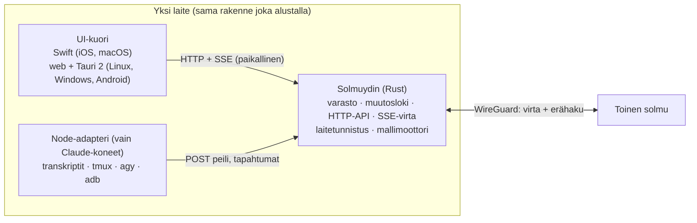

# scopes architecture — arkkitehtuurisuunnitelma

Kirjoitettu 19.10.2026 (paketti ARCHITECTURE-SUUNNITELMA, Fable). Pohja: `ESITIEDOT.md` (E-xx, K-x, V-x).
Päätökset K-1…K-8 tehty käyttäjän kanssa 19.10.2026; K-2:n toteutuksen valitsi suunnittelija (luku 4).
Tämä skooppi omistaa päätökset; koodimuutokset tehdään omistajaskoopeissa luvun 9 paketteina.
Päivitetty 19.10.2026 (K-9, käyttäjä): uusi äppi on **scopes-V2** erillisenä rakenteena `scopes2/**`; vanha scopes-äppi ja palvelu pysyvät ajossa rinnalla, kunnes V2 toimii. Muutos koskee lukuja 1, 2, 7, 9 ja 10.
Päivitetty 20.10.2026 (V-586, käyttäjä scopes macos -istunnossa "Hyväksyn kaikki"): ARK-16 arkkitehtuurin paketiksi (luku 9) ja K-10 puhelimen transkriptipeilin aikaikkuna (H-16; mitoitus luku 8, käyttäjä hyväksyi 20.10.2026; toteutus ARK-17). Muutos koskee lukuja 1, 8, 9 ja 10.
Päivitetty 20.10.2026 (V-583, käyttäjä): K-11 macOS-äpin kehitysasetukset ja ARK-18. Muutos koskee lukuja 1 ja 9.
Päivitetty 20.10.2026 (V-614, suunnittelija): toteutussopimuksen S-9b tarkastettu; luku 8 sai ikkunoidun polun replikointisäännöt (ikkunoitu solmu ei ole lähde, vetohaun alaraja = karsinnan raja).
Päivitetty 21.10.2026 (suunnittelija, toteutussuunnitelman kysymys 31e16080): luku 9 sai päätöksen sillan muista reiteistä ja paketin ARK-19; luvun 7 kohdan 6 esiehdoiksi tulivat ARK-16 ja ARK-19.

## 1. Päätökset (K-1…K-8)

| K | Päätös | Perustelu / viite |
|---|---|---|
| K-1 | **Solmuverkko**: jokainen oma laite on täysi solmu ja palvelin toisilleen. Kaikki äpin data replikoidaan joka solmuun; Claude-transkriptit peilataan lisäyksinä alkuperäsolmulta. Äppi voi olla **headless**-tilassa, jolloin UI-tilaa ei synkata. | V-2, taulukko D. Työ jatkuu miltä tahansa laitteelta myös offline. |
| K-1b | Kaikki viisi alustaa ovat täysiä solmuja, myös iOS ja Android. | Käyttäjä 19.10.2026. Puhelimen rajoitteet luku 8. |
| K-2 | **Muutosloki + SSE-virta versiokursorilla** sekä UI:lle että solmujen väliseen replikointiin. Tapahtumat syntyvät ytimen kirjoituspoluista ja adapterin tiedostoseurannasta. | Suunnittelijan valinta, luku 4. E-60…E-62. |
| K-3 | **Erillinen tilavarasto** (avain–arvo, viimeinen kirjoitus voittaa) solmuytimessä; LR pysyy rekisterien synkkamoottorina, sen yksikkölajia ei laajenneta. | E-72: LR:n kattavuus on lukittu rekisteritiedostoihin. |
| K-4 | **UI**: Swift (ScopesCore + ScopesUI oikeasti jaettuna) iOS:lle ja macOS:lle; **yksi TypeScript-web-asiakas** Linuxille, Windowsille ja Androidille Tauri 2 -kuoressa (PWA ensin). | E-01…E-13. Sopimus on API + virta + tilavarasto. |
| K-4b | **Solmuydin Rustilla** (synkka, varasto, HTTP-API, virta, laitetunnistus, mallimoottori) kaikille alustoille; **Node-palvelu jää adapteriksi** Claude-koneille (transkriptit, tmux, agy, adb). | Yksi toteutus logiikalle, joka ajaa myös puhelimissa. |
| K-5 | **Laiteavainpari ja paritus**: ed25519-avainpari per laite, synkattu laiterekisteri, allekirjoitettu pyyntö. Yhteinen Bearer-avain poistuu siirtymän jälkeen. Ilmoitus kuitataan kerran, kuittaus synkataan. | E-46, E-52, E-80. |
| K-6 | **Suorituskyky ensin**: Node-palvelun transkriptien inkrementaalinen luku ja välimuisti + tiedostoseuranta ennen virtaa ja ydintä. | E-20…E-26: välimuisti on virran ja adapteriroolin edellytys. |
| K-7 | **WireGuard-verkko, peer per laite, käyttöjärjestelmän WG-asiakas** Linuxilla, Windowsilla ja Androidilla; iOS nykyinen äpin tunneli. Kotiverkossa suora yhteys ensin. `wg-asetus`-reitti pois HTTP:ltä. | E-81, E-82. |
| K-8 | **Mallimoottori solmuytimessä** (llama.cpp-sidos Rustissa, sama kaikilla alustoilla). Keskustelu on synkattavaa dataa; ajava laite kirjoittaa vastauksen osina muutoslokiin, muut näkevät virran. `models`-skooppi omistaa mallivalinnan ja rajat. | V-4, E-85…E-88. |
| K-9 | **scopes-V2 rinnalla**: uusi äppi on erillinen äppi `scopes-V2` erillisessä rakenteessa `scopes2/**` (oma bundle-id, ydin omassa portissa, oma Node-adapteri). Vanha scopes-äppi ja Node-palvelu 8787:ssä pysyvät koskemattomina ja ajossa, kunnes V2 on toimiva; vanhan alasajo on käyttäjän erillinen päätös. | Käyttäjä 19.10.2026. Vanhan on toimittava koko siirtymän ajan ilman riskiä; V2 näyttää vanhan datan lukusillalla (luku 7). |
| K-10 | **Puhelimen transkriptipeili on aikaikkuna** (poikkeus K-1:n "kaikki data joka solmuun" -periaatteeseen vain transkriptipeileille): fyysinen iPhone (ja Android, ARK-13) ei replikoi koko peiliä. Muu äpin data (rekisterit, tila, chatit, asetukset) replikoidaan edelleen kokonaan. Ikkunan sisältö ja koko luvussa 8 (käyttäjä hyväksyi 20.10.2026), toteutus ARK-17. | Käyttäjä 20.10.2026 (V-586, H-16). Peili on tuotannossa 2,6 Gt (`~/.claude/projects`) ja ytimen `ydin.db` 2,8 Gt; luvun 8 aiempi 38 Mt (E-20) oli vain elävien istuntojen koko. |
| K-11 | **macOS-äpin Kehitys-osio** asetuksissa (laitekohtainen, ei synkata, luku 3.1): (1) **Näyttö hereillä** -kytkin, tila näkyvissä; päällä äppi herättää näytön (`IOPMAssertionDeclareUserActivity`, vastaa `caffeinate -u`) ja pitää väitteen `PreventUserIdleDisplaySleep`; (2) **vain luettava diagnostiikka**: oman ytimen portti ja tila, data-hakemisto, vertaisyhteys, binäärin versio. Ei asetuksiin: koeytimen tunneli ja kertakäyttöavain (gate, P-14; salaisuudet eivät UI-asetuksiin) eikä `SCOPES2_DATA` (vain testit). **Gate** käynnistää UI-testin äpin argumentilla `-scopes2.naytto-hereilla YES` (UserDefaults-argumenttialue), joten väite elää testiajon ajan ilman ssh:n `caffeinate`a. | Käyttäjä 20.10.2026 (V-583; toteutus V-584, ARK-18). Rajoite: lukittua näyttöä kytkin ei avaa, käyttäjä avaa sen kerran. |

## 2. Kokonaiskuva

Kerrokset:

1. **UI-kuori** puhuu vain oman laitteensa ytimelle (`127.0.0.1`). Se ei tiedä muista solmuista.
2. **Solmuydin** (Rust-kirjasto + ohut palvelinprosessi tai äpin sisäinen säie) omistaa datan, replikoi sen muihin solmuihin ja tarjoaa API:n. Sama binääri headless-tilassa ilman UI:ta.
3. **Node-adapteri** ajaa vain koneilla, joilla ajaa Claude CLI (palvelin, palvelin, Mac). Se lukee lähteet, joihin ytimellä ei ole pääsyä (transkriptit, tmux, agy-SQLite, adb), ja kirjoittaa ne ytimeen peileinä. Siirtymän aikana se vastaa nykyisistä reiteistä (luku 7).
4. **Yhteys**: WireGuard-verkko, jossa jokaisella laitteella on oma peer. Kotiverkossa suora osoite ensin (E-82:n Reitti-malli kaikille).

Mikä muuttuu nykyisestä: nyt on yksi palvelin (palvelin) ja ohuet asiakkaat, jotka pollaavat. Jatkossa jokaisella laitteella on täysi kopio ja oma API; palvelimen rooli jää Claude-istuntojen ajamiseen.

K-9: kuvan rakenne toteutetaan kokonaan uutena äppinä **scopes-V2** (`scopes2/**`). Vanha scopes-äppi ja sen Node-palvelu 8787:ssä eivät ole kuvan osia eikä niitä muuteta V2:n takia; ne ajavat rinnalla, kunnes V2 toimii. Node-adapteri on uusi prosessi `scopes2/adapteri` samoilla lähteillä (transkriptit, tmux, agy, adb), ei vanhan palvelun muunnos.

## 3. Data: lajit, omistus, synkka

### 3.1 Datalajit

| Laji | Yksikkö | Omistaja | Konfliktisääntö | Nyt (ESITIEDOT) |
|---|---|---|---|---|
| Rekisterit (REKISTERI/HISTORIA/ARKISTO.md) | LR-yksikkö `<laite>-<laskuri>` | kaikki solmut | LR: versiovektori, rinnakkaiset käyttäjälle | E-70…E-77 |
| Äpin tila (luonnos, valittu skooppi, vierityskohta, purku-/agy-valinnat, piilotukset, suodatin) | avain–arvo `tila/<avain>` | kaikki solmut | viimeinen kirjoitus voittaa (HLC-aikaleima, laite-id tasapeliin) | E-40…E-45 |
| Ilmoituskuittaus, luettu-raja | `tila/kuittaus/<skooppi>` | kaikki solmut | suurin arvo voittaa | E-46, E-47 |
| Chat-historiat (Claude, agy, Gemini, paikalliset, Nebius) | keskustelu + viesti | kirjoittava solmu per viesti | lisäys, ei muokkausta; osaviestit korvaavat edellisen osan | E-50, E-86 |
| Liitteet | sisältö SHA-256:lla, metatieto yksikkönä | lisäävä solmu | sisältö muuttumaton | E-41, E-90 |
| Asetukset (`/api/asetukset`, istuntoasetukset) | avain–arvo | kaikki solmut | viimeinen kirjoitus voittaa | E-50 |
| Laiterekisteri | laite-id, nimi, alusta, rooli, julkiset avaimet, mallit, viimeksi nähty | laite itse | laite kirjoittaa omansa | E-52 |
| Transkriptipeilit (`~/.claude/projects/*.jsonl`, istunnot) | rivilisäys (tiedosto, offset) | alkuperäsolmu | vain lisäys; muut lukevat | E-20, E-61 |
| Agy-tila, Android-ruutu, käyttöraja | peili / välimuisti | alkuperäsolmu | ei synkkaa (lyhytikäinen) | E-25, E-26, E-27 |
| Laitekohtaista (ei synkata) | ulkoasu, palvelimen osoite, Reitti, avaimet, LR-laite-id | laite | — | E-49 |

Headless-tila: solmu ei lähetä eikä sovella `tila/*`-yksiköitä UI-tilasta (luonnos, sijainti, vierityskohta). Kuittaukset, asetukset ja data synkataan silti.

### 3.2 Yksikkömalli

Yksi yksikkömalli kaikille lajeille (LR:n malli yleistettynä, E-70, E-71):

- `polku` (laji/kokoelma), `id` = `<laite>-<laskuri>`, `versio` = `{laite: laskuri}`, `aika` = HLC, `sisalto` (JSON tai teksti), `poistettu` (tombstone).
- Lajikohtainen **yhdistäjä**: LR-yhdistäjä (rinnakkaiset säilytetään) rekistereille; LWW-yhdistäjä tilalle ja asetuksille; lisäysyhdistäjä viesteille ja peileille.
- Varasto: SQLite ytimessä (`yksikot`, `muutosloki`, `laitteet`, `liitteet`). LR:n JSON-tiedostohakemisto (`~/.local/share/localregister/rekisterit`) jää tuonnin/viennin välimuodoksi siirtymän ajaksi ja poistuu, kun LR-protokolla palvelee ytimestä (ARK-12).

### 3.3 Replikointi

- Jokainen solmu pitää **muutoslokia**: `(seq, polku, id, versio)` omille ja vastaanotetuille muutoksille, `seq` kasvaa solmukohtaisesti.
- Solmu tilaa jokaisen tavoitettavan vertaisen virran kursorilla `since=<vertaisen seq>` ja hakee muuttuneet yksiköt erissä (LR:n protokolla E-74 yleistettynä: tiiviste → listat → hae/lähetä, erä 300–400).
- Ensisynkka ja katko: tiivistevertailu polkukohtaisesti, sitten erähaku. Kursorit tallennetaan per vertainen.
- Transkriptipeili: adapteri lähettää ytimelle `(tiedosto, offset, rivit)` lisäyksinä; ydin tallettaa rivit ja muutoslokimerkinnän. Vastaanottava solmu ei jäsennä transkriptia uudelleen joka pyynnöllä (E-20): ydin pitää johdetut näkymät (skooppi, viimeisin viesti, konteksti) päivittyvinä lisäyksittäin.
- Liitteet: sisältö siirretään erikseen tiivisteellä (`GET /api/liite/<sha>`), metatieto kulkee muutoslokissa; puhelin voi jättää suuret sisällöt hakematta ennen käyttöä.

## 4. Muutosten välitys (K-2: suunnittelijan valinta)

Valinta: **SSE-virta + muutosloki + versiokursori**. Sama mekanismi UI:lle ja solmuille.

- `GET /api/virta?since=<seq>` palauttaa `text/event-stream`-virran; tapahtuma `{seq, polku, id, versio}`; `Last-Event-ID` jatkaa katkon jälkeen. Keep-alive 20 s. Sulkeutuessa asiakas hakee `since`-erän ja avaa uudelleen.
- Listareitit saavat `?since=<seq>`-parametrin ja vastaavat vain muuttuneet (E-32, E-62 ratkeavat samalla).
- Tapahtumien lähteet: (a) kaikki ytimen kirjoituspolut, (b) adapterin tiedostoseuranta `fs.watch` transkripti-, istunto- ja rekisterihakemistoille (poll 2 s varalla, koska `fs.watch` ei ole luotettava kaikilla tiedostojärjestelmillä), (c) vertaisen virrasta vastaanotetut muutokset.
- Miksi ei WebSocket: kirjoitukset ovat HTTP POST -pyyntöjä, kaksisuuntaisuutta ei tarvita; Node 22:ssa ei ole WS-palvelinta (E-64) ja selaimen `EventSource`, Swiftin `URLSession.bytes` ja Rustin `reqwest` jatkavat SSE:tä ilman omaa kehystä. Miksi ei pitkä pollaus: katkot ja yhteyksien uudelleenavaus WG:n yli ovat kalliimpia kuin yksi pysyvä virta.
- Pollaus jää vain varalle (60 s) ja puhelinten taustahakuun (E-63).
- Odotettu vaikutus: `/api/skoopit`-kutsut 702/18 h → noin 10/18 h (vain muutokset); viestin näkyminen toisella laitteella < 1 s nykyisen 5–10 s sijaan.

## 5. Laitteet, paritus ja avaimet (K-5, K-7)

- Laite luo ensikäynnistyksessä ed25519-avainparin (identiteetti) ja WG-avainparin. Yksityiset avaimet pysyvät laitteella (Keychain, Credential Manager, Android Keystore, Linux secret service tai tiedosto 0600).
- **Paritus**: olemassa oleva solmu näyttää kertakoodin (QR tai 8 merkkiä, 10 min); uusi laite lähettää laiterekisteriyksikön (id, nimi, alusta, julkiset avaimet) koodilla allekirjoitettuna. Parittava solmu hyväksyy, kirjaa yksikön ja lisää WG-peerin (hubiin `wg.brainpower-now.com` ja omaan WG-asetukseensa). Laiterekisteri replikoituu, joten jokainen solmu tuntee uuden laitteen ilman erillistä avaintenvaihtoa.
- **Pyynnön tunnistus**: otsikot `Laite: <id>` ja `Allekirjoitus: ed25519(aika + metodi + polku + runkotiiviste)`, aikaikkuna 5 min. Ei yhteisiä salaisuuksia synkattavassa datassa. Siirtymän ajan (luku 7) ydin hyväksyy myös nykyisen Bearer-avaimen.
- **Yhteys**: kotiverkossa suora osoite (mDNS tai laiterekisterin viimeksi nähty osoite), muuten WG-osoite. Linux, Windows ja Android käyttävät käyttöjärjestelmän WG-asiakasta; iOS nykyistä äpin sisäistä tunnelia (E-82). `GET /api/wg-asetus` poistuu (E-81): WG-asetus annetaan kerran parituksessa, ja hubin peer-lista päivitetään parituksessa.
- Ilmoitukset: solmu, jonka UI näyttää ilmoituksen ensimmäisenä, kirjoittaa kuittauksen; muut solmut peruvat saman ilmoituksen kuittauksen saapuessa (E-46).

## 6. Mallimoottori (K-8, V-4)

- Rajapinta `Mallimoottori` ytimessä: `lataa(malli)`, `vastaa(keskustelu) -> virta`, `vapauta()`. Toteutus `llama.cpp` Rust-sidoksella (`llama-cpp-2`), jolloin sama koodi ajaa iOS:llä (Metal), macOS:llä (Metal), Linuxilla ja Windowsilla (CPU, Vulkan/CUDA kun saatavilla) ja Androidilla (CPU, Vulkan). Ei erillistä ohjelmistoa (LM Studio poistuu, E-85).
- Mallitiedostot (GGUF) ladataan laitekohtaisesti; laiterekisteriyksikkö kertoo, mitkä mallit laitteella on ja riittääkö muisti. `kaikkiMallit` (E-86) kootaan ytimessä: pilvimallit, Claude-adapteri, paikalliset mallit per laite.
- Keskustelu on synkattavaa dataa (luku 3.1). Käyttäjä voi jatkaa keskustelua millä tahansa laitteella; vastaus ajetaan sillä laitteella, josta viesti lähetetään, tai valitulla solmulla (`ajaja`-kenttä: "tämä laite" tai laite-id). Ajava laite kirjoittaa osaviestejä (yhdistetty 100 ms välein) muutoslokiin; muut näkevät virran luvun 4 mekanismilla ilman erillistä stream-reittiä.
- Vastuut: `models`-skooppi (E-88) omistaa mallilistan, rajat ja mittauksen; `scopes2 ydin` ajon; UI-kuoret vain valinnan ja näytön.
- Rajaus nyt: V-4 jää arkkitehtuuriin tilana (rajapinta, laiterekisterin mallikenttä, keskustelun `ajaja`); toteutus on vaiheen 6 paketti.

## 7. Siirtymä: scopes-V2 rinnalla (K-9)

Vanha scopes-äppi (iOS, macOS) ja Node-palvelu portissa 8787 pysyvät koskemattomina ja ajossa koko siirtymän ajan. scopes-V2 rakennetaan erilliseen puuhun `scopes2/**` omalla bundle-id:llä, omalla portilla (ei 8787; portin valitsee `scopes toteutussuunnitelma`) ja omalla adapterilla. Kumpikin äppi voi olla asennettuna samalla laitteella. Vanhan alasajo on käyttäjän erillinen päätös sen jälkeen, kun V2 täyttää ARK-09:n hyväksynnän.

1. **Vaihe 2 — Rust-ydin palvelimelle** (`scopes2/ydin`): ydin kuuntelee omassa portissaan; uusi Node-adapteri `scopes2/adapteri` lukee samat lähteet kuin vanha palvelu (transkriptit, tmux, agy, adb) ja kirjoittaa ne ytimeen peileinä. Ydin tarjoaa **lukusillan** vanhaan 8787:ään (skoopit, viestit, liitteet, toiminnot), jotta V2 näyttää saman tilan kuin vanha äppi ennen kuin kaikki lähteet ovat ytimessä. Ydin liittyy LR-verkkoon vertaisena lukutilassa (ARK-12 aikaistettu), joten rekisterit ovat samat molemmissa.
2. **Vaihe 3 — Apple**: uudet äpit `scopes2/ios`, `scopes2/macos` ja jaettu `scopes2/shared` ytimen päälle (`127.0.0.1`-API, UniFFI vasta tarvittaessa). Vanhan äpin kahdennuksia (E-01…E-09) ei pureta: ne jäävät vanhaan puuhun ja poistuvat sen mukana.
3. **Vaihe 4 — muut alustat**: web-asiakas (PWA ytimestä tarjoiltuna) → Tauri 2 -kuoret Linux, Windows, Android.
4. **Vaihe 5 — paritus ja avaimet**: laiterekisteri, allekirjoitettu tunnistus, WG-peer per laite. Vanha palvelu pitää Bearer-avaimensa alasajoon asti; V2 ei käytä sitä muuhun kuin lukusiltaan.
5. **Vaihe 6 — mallimoottori**.
6. **Vanhan alasajo** (käyttäjän päätös): vanha äppi poistetaan laitteilta ja 8787-palvelu sammutetaan; lukusilta poistuu ytimestä.

Pois jääneet vaiheet: alkuperäiset vaihe 0 (Node nopeaksi, ARK-01) ja vaihe 1 (virta Nodeen, ARK-02, ARK-03) olivat vanhan palvelun ja äppien paikallaan-muutoksia. K-9:n jälkeen ne eivät ole V2-polulla; suorituskyky (K-6) ja virta (K-2) toteutetaan suoraan ytimessä ja uudessa adapterissa. Vanhan äpin ylläpito on edelleen mahdollista omistajaskoopeissa, mutta vain käyttäjän erillisestä pyynnöstä.

Yhteensopivuus: `git`-vienti rekistereistä toimii joka vaiheessa (LR:n `vie`), eikä yhdenkään vaiheen peruminen hävitä dataa (SQLite + git). Vanha äppi ei lakkaa toimimasta missään vaiheessa, koska sen koodia ja porttia ei muuteta.

## 8. Puhelimet täysinä solmuina — rajoitteet ja ratkaisut

- iOS ei salli pysyvää taustapalvelinta. Solmu palvelee muita vain äpin ollessa etualalla tai lyhyen taustakäsittelyn ajan (`BGProcessingTask`, `BGAppRefreshTask` 15 min, E-63). Ratkaisu: muut solmut pitävät puhelimen muutokset itse (replikoitu data), ja puhelin täydentää omansa aina etualalle tullessaan; puhelin on harvoin ainoa lähde millekään datalle paitsi omalle luonnokselleen.
- Android: etualapalvelu (`foregroundService`) pitää solmun hengissä käyttäjän luvalla; Tauri 2 -kuori + Rust-ydin samassa prosessissa.
- Muisti ja levy: LR 35 Mt (E-73) mahtuu puhelimeen; suuret liitteet haetaan tarvittaessa (luku 3.3). Transkriptipeili ei mahdu kokonaan (K-10): E-20:n 38 Mt oli vain kuuden elävän istunnon koko, koko peili on 2,6 Gt.
- **Transkriptipeilin aikaikkuna (K-10, H-16; suunnittelijan ehdotus, käyttäjä hyväksyi 20.10.2026):**
  - Mittaus palvelimella 20.10.2026 (rivien `timestamp`, 6.–20.10.): raakarivejä 1–340 Mt/vrk; käyttäjän ja Clauden viestitekstiä (`content`-merkkijono ja `text`-lohkot) 0,1–7,3 Mt/vrk, liukuva 7 vrk enintään 20,7 Mt. Työkalutulokset, ajattelu ja metatieto ovat noin 96 % tavuista.
  - Puhelin pitää **7 vrk:n ikkunan viestitekstiä** ja ytimen johdetut näkymät (skooppi, viimeisin viesti, konteksti; luku 3.3) kaikista istunnoista. **Katto 38 Mt**: ylityksessä vanhin vuorokausi karsitaan ensin; mitattu huippu käyttää katosta noin puolet.
  - Ikkunan ulkopuoliset istunnot näkyvät otsikkotasolla (luku 10, ARK-06:n karsinta). Raakarivit (työkalutulokset, ajattelu) ja vanhemmat viestit haetaan pyynnöstä täydeltä solmulta (Mac, palvelin) samalla erähaulla kuin replikointi; offline-tilassa ne puuttuvat, mikä hyväksytään.
  - Ikkuna ja katto ovat laitekohtaisia asetuksia (luku 3.1, ei synkata): oletus 7 vrk / 38 Mt. Replikoinnin karsinta tehdään vastaanottavassa ytimessä; lähettävä solmu ei tiedä vastaanottajan ikkunaa, vain sen, että polku on ikkunoitu (toteutussopimuksen S-9b `ikkunoidut`, tarkastettu 20.10.2026, V-614).
  - **Ikkunan aikaperusta on transkriptin aika, ei tuontiaika (suunnittelija 21.10.2026, T-57 fbe58e3c).** K-10:n mitoitus laskettiin rivien `timestamp`-kentästä (mittaus yllä), joten myös ikkuna ja katon vuorokausikarsinta lasketaan siitä. Peiliyksikön sisältöaika on sen rivien uusin `timestamp`. Jos yksikön riveillä ei ole aikaleimaa, käytetään yksikön HLC-aikaa. HLC kertoo vain, milloin adapteri toi rivit ytimeen, ja se on versiointia varten: koko 2,6 Gt:n peilin tuonti 19.–20.10.2026 antoi kaikille 14 230 yksikölle saman parin päivän HLC-ajan, joten 7 vrk:n ikkuna ei rajannut mitään. Sisältöajan on näyttävä peiliyksikön otsakkeessa (`/api/listat`), jotta ikkunoitu solmu voi rajata vetohaun hakematta sisältöä. Kaikki solmut laskevat sen kirjoitushetkellä samalla tavalla.
  - Replikoinnin säännöt ikkunoidulle polulle (V-614):
    - **Ikkunoitu solmu ei ole polun lähde muille solmuille.** Sen `/api/listat` ja `/api/hae` eivät palauta ikkunoidun polun yksiköitä, ja täysi solmu ohittaa vertaisen ikkunoidut polut myös virran soveltamisessa, ei vain tasauksessa. Perustelu: riisuttu yksikkö säilyttää alkuperäisen `id`:n, `versio`n ja `aika`n (S-9a), ja tiiviste lasketaan vain `id`:stä ja `versio`sta (`varasto.rs:290-303`). Jos täysi solmu hakisi yksikön ikkunoidulta, riisuttu sisältö jäisi siihen pysyvästi, koska mikään vertailu ei näe eroa. Tilanne syntyy, kun täysi solmu saa puhelimen virtatapahtuman ennen alkuperäistä lähdettä, esimerkiksi uusi tai pitkään poissa ollut täysi solmu. Puhelin ei kirjoita peiliä itse, joten säännöstä ei katoa dataa.
    - **Vetohaun alaraja on sama kuin karsinnan raja.** Ikkunoitu solmu hakee peilistä vain yksiköt, joiden aika on vähintään max(nyt − ikkuna, katon karsintaraja). Karsintaraja on katon takia karsitun vanhimman UTC-vuorokauden loppu, ja se tallennetaan sisäiseen polkuun, joka ei replikoidu ja säilyy uudelleenkäynnistyksen yli. Muuten katon takia ikkunan sisältä karsitut yksiköt haettaisiin uudelleen joka kierroksella ja karsittaisiin taas.
    - Karsinta poistaa yksiköt fyysisesti ilman hautakiveä ja muutoslokiriviä, joten karsinta ei leviä muille solmuille. Täysien solmujen keskinäinen replikointi pysyy ennallaan.
  - Toteutus on paketti ARK-17 (luku 9; `scopes2 ydin` + `scopes2 ios`, riippuu ARK-08:sta); se ei estä ARK-08:aa macOS:llä eikä simulaattorissa, jotka ovat täysiä solmuja Macin levyllä (P-17).
- Mallinajo puhelimessa rajataan laiterekisterin muistitietoon (luku 6).

## 9. Toteutuspaketit omistajaskoopeille

Tunnus ARK-nn. Jokainen paketti kirjataan omistajaskoopin rekisteriin `SEURAAVA PAKETTI`-riviksi tai avoimeksi asiaksi vasta käyttäjän pyynnöstä (TYÖTAVAT 15). Hyväksyntä on mitattava; ajaja ehdotetaan, lopullinen reititys kuuluu paketin aloittajalle.

K-9 (19.10.2026): V2-polun paketit kirjoitetaan polkuihin `scopes2/**` ja skoopeille `scopes2 ydin|adapteri|shared|ios|macos|web|linux|windows|android`. Yksikään V2-paketti ei muuta `scopes/`-polkuja (hyväksyntäehto kaikille). Tehtävätason muunnos ja briefit kuuluvat `scopes toteutussuunnitelma` -skoopille (paketti TOTEUTUSSUUNNITELMA-SCOPES2); alla ARK-numerot säilyvät, ja muuttuneet rivit on merkitty.

### Vaihe 0 — suorituskyky (K-6) — EI V2-POLULLA (K-9)

ARK-01 muuttaa vanhaa palvelua. K-9:n jälkeen se on vanhan äpin ylläpitoa: tehdään vain käyttäjän erillisestä pyynnöstä, ei kuulu ARCHITECTURE-JAKELUun. Suorituskykyvaatimukset (E-20…E-26) siirtyvät ARK-06:n adapteriin ja ytimen johdettuihin näkymiin.

| Paketti | Skooppi | Polut | Sisältö | Hyväksyntä | Riippuu |
|---|---|---|---|---|---|
| ARK-01 | `scopes performance` (määrittelee skoopin: palvelun suorituskyky) | `scopes/palvelu/lahteet.mjs`, `viestit.mjs`, `agy-istunto.mjs`, `diagnostiikka.mjs` | Transkriptin inkrementaalinen luku: tiedostokohtainen välimuisti `(polku, koko, mtime) → jäsennetty tila`, luetaan vain lisäys offsetista; `istunnot()` jäsentää kerran, ei 5 kertaa (E-20). `/api/skoopit/X` ja `/viestit` käyttävät samaa välimuistia (E-21). `execFileSync` → async; `capture-pane` vain agy-reiteille, ei `/api/skoopit`-kutsussa (E-25). `statSync` 500 .db:n yli välimuistiin (E-22). `/api/android/ruutu` 1 s välimuisti (E-26). Toimitusvarmistus (E-24) käyttää välimuistia, ei lue koko tiedostoa. | `/api/skoopit` p50 < 100 ms ja `/viestit` p50 < 50 ms 6 istunnolla; `silmukka`-merkintöjä > 500 ms: 0 tunnissa; testit vihreät | — |

### Vaihe 1 — virta Node-palveluun — EI V2-POLULLA (K-9)

ARK-02 ja ARK-03 muuttavat vanhaa palvelua ja vanhoja äppejä. K-9:n jälkeen virta (K-2) toteutetaan suoraan ytimessä (ARK-04) ja uudet äpit käyttävät sitä (ARK-08). Rivit jäävät vanhan ylläpidon paketeiksi, vain käyttäjän erillisestä pyynnöstä.

| Paketti | Skooppi | Polut | Sisältö | Hyväksyntä | Riippuu |
|---|---|---|---|---|---|
| ARK-02 | `scopes yhteys` (reitit; `lahteet.mjs` ja `viestit.mjs` ovat `scopes infra`/`scopes chat` -tiedostoja, muutos kirjataan niille) | `scopes/palvelu/palvelin.mjs`, uusi `scopes/palvelu/virta.mjs`, `lahteet.mjs`, `viestit.mjs` | Muutosloki (`seq`, laji, avain, aika) muistissa + tiedostossa; `fs.watch` + 2 s poll transkripti-, istunto- ja rekisterihakemistoille ja kaikille kirjoituspoluille; `GET /api/virta?since=` SSE `Last-Event-ID`:llä; `since` `/api/skoopit`-, `/viestit`- ja `/api/agentit`-reiteille. `POST /api/skoopit/X/stream` aidoksi virraksi tai poistoon (E-24). | Kahdella asiakkaalla viesti näkyy toisessa < 1 s; `/api/skoopit`-kutsuja < 20 tunnissa kahdella äpillä; katkosta toipuminen testattu (`Last-Event-ID`) | ARK-01 |
| ARK-03 | `scopes ios`, `scopes macos` (iOS: `scopes lista`, `scopes chat`, `scopes notifications` tiedostoittain) | `ios/Sources/Ilmoitukset.swift`, `Sivupalkki.swift`, `Viestit.swift`, `macos/Sources/MacRootView.swift`, `shared/ScopesCore/.../ScopesClient.swift` | `ScopesClient.virta(since:)` ScopesCoreen (`URLSession.bytes`); pollaus pois (E-30, E-31); `scenePhase`-tarkistus; listat päivitetään `since`-erolla, ei korvaamalla (E-32); vakaat tunnisteet `Viesti.id`, `PyyntoTapahtuma.id` (E-34); chat `LazyVStack` ja vieritys vain loppuun jäätäessä (E-33). | iOS tekee < 5 listapyyntöä minuutissa taustalla 0; UI-testit vihreät; macOS `/api/kayttoraja` vain 15 min välein | ARK-02 |

### Vaihe 2 — Rust-ydin

Uudet skoopit `scopes2 ydin` (`/pura uusi scopes2 ydin — scopes-V2:n solmuydin Rustilla`), polut `scopes2/ydin/**`, ja `scopes2 adapteri`, polut `scopes2/adapteri/**` (K-9). Esiehto: Rust-työkaluketju palvelimelle (Debian 13 aarch64, `rustup`, ei rootia) ja Macille (macOS 27); kumpaakaan ei ole asennettu 19.10.2026.

| Paketti | Skooppi | Polut | Sisältö | Hyväksyntä | Riippuu |
|---|---|---|---|---|---|
| ARK-04 (K-9: polut ja portti) | `scopes2 ydin` | `scopes2/ydin/Cargo.toml`, `scopes2/ydin/src/{varasto,yksikko,muutosloki,api,virta}.rs` | Crate `scopes-ydin`: yksikkömalli (3.2) ja yhdistäjät (LR, LWW, lisäys) `lr.mjs`:n semantiikalla; `lr.test.mjs`:n 16 tapausta siirretään Rust-testeiksi; SQLite-varasto; muutosloki; HTTP-API (axum) `127.0.0.1:<V2-portti>` (ei 8787); SSE-virta (luku 4) ja `since`-listareitit määritellään tässä (ARK-02 ei edellä); headless-binääri `scopes-solmu` (`--headless`). | `cargo test` vihreä; LR-pariteettitestit vihreät; `scopes-solmu` vastaa `GET /api/virta` ja `GET/PUT /api/tila/<avain>` | Rust-työkaluketju |
| ARK-05 (K-9: polut) | `scopes2 ydin` | `scopes2/ydin/src/{replikointi,vertaiset}.rs` | Vertaisten virran tilaus kursorilla, tiiviste → listat → hae/lähetä -erähaku (E-74 yleistettynä), kursorit per vertainen, katkon toipuminen; kahden solmun integraatiotesti samalla koneella (eri portit). | 2 solmua konvergoivat 1 000 yksikköä 10 s:ssa; katko kesken erän → sama lopputila | ARK-04 |
| ARK-06 (K-9: uusi adapteri, ei proxya) | `scopes2 ydin` + `scopes2 adapteri` | `scopes2/ydin/src/silta.rs`, `scopes2/adapteri/**`, `scopes2/kaynnista.sh` | Uusi Node-adapteri `scopes2/adapteri` lukee transkriptit, tmuxin, agyn ja adb:n inkrementaalisesti välimuistilla (E-20…E-26 tässä) ja kirjoittaa ne ytimeen (`POST /api/peili` lisäyksinä `fs.watch`-tapahtumista); ydin tarjoaa reitit skoopit, viestit, viesti, liite, toiminnot ja **lukusillan** vanhaan 8787:ään niille tiedoille, joita adapteri ei vielä tuota. Vanhaa `scopes/palvelu` ei muuteta; 8787 pysyy vanhan äpin. | Vanha iOS ja macOS toimivat muuttamatta 8787:ssä; peili vastaa transkriptin rivejä (tiivistevertailu); `scopes2/kaynnista.sh` käynnistää ytimen ja adapterin; V2-portin `/api/skoopit` p50 < 100 ms | ARK-04 |
| ARK-07 (K-9: polut) | `scopes2 ydin` | `scopes2/ydin/src/tila.rs`, API `GET/PUT /api/tila/*`, `/api/tila/kuittaus/*` | Tilavarasto (K-3): avaimet luvun 3.1 mukaan, LWW HLC:llä, headless-lippu suodattaa UI-avaimet; kuittaukset suurin-voittaa. | Luonnos kirjoitettu laitteella A näkyy laitteella B < 1 s; headless-solmu ei kirjoita UI-avaimia | ARK-04 |

### Vaihe 3 — Apple-äpit ytimen päälle (K-9: uudet äpit `scopes2/ios|macos|shared`)

ARK-12 (ydin LR-vertaisena, lukutila) tehdään ennen tätä vaihetta, jotta V2-äpit näkevät samat rekisterit kuin vanha.

| Paketti | Skooppi | Polut | Sisältö | Hyväksyntä | Riippuu |
|---|---|---|---|---|---|
| ARK-08 (K-9: uudet äpit, ei MULTI-01) | `scopes2 shared`, `scopes2 ios`, `scopes2 macos` | `scopes2/shared/**`, `scopes2/ios/**`, `scopes2/macos/**` | Uudet Xcode-projektit omalla bundle-id:llä (`…scopes-v2`), nimi **scopes-V2**; yksi jaettu ScopesCore ja ScopesUI alusta alkaen (E-01…E-09 ratkeavat rakenteella, ei purkamalla); ydin prosessin sisällä (`127.0.0.1`-API ensin, UniFFI vasta tarvittaessa); liitteet ytimen reitille `POST /api/skoopit/<nimi>/liite` (E-90 ei peri vanhaa vikaa). Vanhan äpin koodia ei muuteta eikä poisteta. | scopes2-gate vihreä iOS:lle ja macOS:lle; V2 ja vanha asennettuina samalla laitteella molemmat toimivat; V2 näyttää saman skooppilistan ja viestit kuin vanha (lukusilta + peili); macOS-liite näkyy palvelimen istunnossa | ARK-06, ARK-07, ARK-12 |
| ARK-09 (K-9: skoopit) | `scopes2 ios`, `scopes2 macos` | äpin tilan käyttö | UI käyttää `tila/*`-avaimia (E-40…E-45, E-47) ja synkattua kuittausta (E-46; `scopes notifications`); headless-kytkin asetuksiin. | Laitteelta toiselle siirtyminen: sama skooppi, luonnos ja vierityskohta auki < 2 s; kuittaus yhdellä, hiljenee toisella | ARK-07, ARK-08 |
| ARK-16 (K-9:n seuraus; käyttäjä 20.10.2026, V-586) | `scopes2 adapteri` (+ `scopes2 ydin` silta) | `scopes2/adapteri/**`, `scopes2/ydin/src/silta.rs` | Adapteri ottaa toiminnot itselleen ennen vanhan alasajoa: `viesti`, `liite`, `stop` ja kysymys-pois tmuxiin, `pura`/`pakkaa`/automaattisiirto/herätä skripteihin, chat; ilman 8787:ää. P-9:n tuonnit (`lahteet.mjs`, `viestit.mjs`) kopioidaan adapteriin. Lukusilta kapenee reitti kerrallaan. Tehtävätaso: `scopes toteutussuunnitelma` (sen SUUNNITELMA.md:n ARK-16-rivit). | Toimintojen portti ja tmux-mock vihreä; siltavertailu vihreä jokaisen siirretyn reitin jälkeen; adapteri ei tuo mitään `scopes/`-polusta | ARK-08 (T-51) |

| ARK-17 (K-10, H-16; käyttäjä 20.10.2026) | `scopes2 ydin` + `scopes2 ios` | `scopes2/ydin/src/{replikointi,peili}.rs`, `scopes2/ios/**`, `scopes2/shared/**` (asetus) | Transkriptipeilin aikaikkuna vastaanottavassa ytimessä (luku 8): laitekohtaiset asetukset ikkuna (oletus 7 vrk) ja katto (oletus 38 Mt); replikoinnissa vain viestiteksti ja johdetut näkymät ikkunan sisältä, vanhemmat istunnot otsikkotasolla; ylityksessä vanhin vuorokausi karsitaan; raakarivit ja vanhemmat viestit pyynnöstä täydeltä solmulta erähaulla; offline-tilassa puuttuva sisältö näytetään haettavana. Täysi solmu (Mac, palvelin, simulaattori) pitää koko peilin (ikkuna pois). | Puhelimen ytimen peili ≤ katto 2,6 Gt:n lähteellä; 7 vrk viestit näkyvät offline; vanhan istunnon avaus hakee rivit täydeltä solmulta; iOS-simulaattori täytenä solmuna ennallaan | ARK-08, ARK-05 |

| ARK-18 (K-11, V-583/V-584; käyttäjä 20.10.2026) | `scopes2 macos` + `scopes2 shared` | `scopes2/macos/Sources/**`, `scopes2/shared/ScopesUI2/Sources/ScopesUI2/AsetuksetNakyma.swift`, `scopes2/shared/gate.sh`, `scopes2/shared/testit/kaksi-laitetta.sh` | Kehitys-osio (K-11): näyttö hereillä -kytkin (UserDefaults `scopes2.naytto-hereilla`, herätys + `PreventUserIdleDisplaySleep`, vapautus kytkimen pois ja äpin lopetuksen yhteydessä) ja vain luettava diagnostiikka; gate välittää macOS-UI-testeille käynnistysargumentin `-scopes2.naytto-hereilla YES`; `caffeinate` pois `kaksi-laitetta.sh`:sta. Osio näkyy vain macOS:llä. | `pmset -g assertions` näyttää äpin väitteen kytkin päällä ja ei pois päältä; T-49 macOS-portti vihreä ilman ssh-`caffeinate`a näytön oltua sammuneena (avattuna); iOS-asetusnäkymä ennallaan | ARK-08 (T-49) |

ARK-16 ja ARK-19 ovat vanhan alasajon esiehtoja (luku 7 kohta 6): kun ne ovat valmiit, V2 ei tarvitse 8787:ää eikä vanhan palvelun koodia.

**Sillan muut reitit (suunnittelija 21.10.2026, kysymys toteutussuunnitelman luvusta 11.6, 31e16080).** Kaikilla S-6:n siltalistan reiteillä (`scopes2/ydin/src/silta.rs:52-110`) on päätös. Sääntö: Claude-koneen paikallinen toiminto (tmux, skripti, tiedosto, adb, ssh) siirtyy adapteriin S-10:n toimintoporttiin, samaan mekanismiin kuin ARK-16:ssa. Lähteestä luettu tila tulee ytimeen adapterin lähdetilan peilinä (S-5b). Reitti, jota vanha äppi ei kutsu tai joka on vain vanhan äpin kehityspaneelin käytössä, jätetään pois V2:sta. Toiminto lisätään myöhemmin omana pakettinaan, jos V2:n käyttöliittymä tarvitsee sitä. Kartoitus vanhasta palvelusta: `scopes/palvelu/palvelin.mjs`, rivit mainittu alla.

| Reitti | Päätös | Peruste |
|---|---|---|
| `POST …/<nimi>/malli` | adapteri, ARK-16 | session `/model` ja `/effort` tmuxilla (`viestit.mjs:833`); vanhan äpin keskustelun mallinappi |
| `POST /api/uusi` | adapteri, ARK-16 | `autovaihto.sh vaihda` (`toiminnot.mjs:134-145`); vanhan iOS-äpin uusi skooppi |
| `GET /api/agentit` | adapteri, ARK-16 chatin mukana | mallilista yhdistää chatin taustat (kiinteät, agy, Gemini, LM Studio, Nebius; `viestit.mjs:571`); siirtyy chatin kanssa. Ytimen paikalliset mallit (K-8, ARK-15) liitetään listaan myöhemmin |
| `/api/asetukset*`, `GET …/<nimi>/asetukset` | lukeminen ytimestä, muuttaminen adapterissa (ARK-16) | `automaattijatko`, `autopack` ja `agyluvat` ovat palvelimen tilatiedostoja (`toiminnot-asetukset.mjs:13-19`), joita Claude-istunnot ja skriptit lukevat. Lähde on tiedosto: adapteri peilaa arvot ytimeen (luku 3.1, asetukset synkattavaa dataa), ja muutos tehdään S-10-toimintona. Ydin ei kirjoita tiedostoja |
| `GET /api/kayttoraja` | ydin | adapterin lähdetila tuo jo käyttörajan ytimeen (`scopes2/adapteri/lahde.mjs:22`) |
| `/api/android*` | luku ytimestä (lähdetila `android`, `lahde.mjs:22`), ohjaus adapterissa, ARK-19 | adb palvelimella (`android.mjs`); vanhassa äpissä Gemini-etäohjaus iOS:llä ja macOS:llä |
| `/api/palvelin*` | adapteri, ARK-19 | ping, WoL ja ssh palvelimelta (`palvelin.mjs:21-46`); vanhan äpin Infra-sivu |
| `POST …/<nimi>/arkistoi` | pois V2:sta | vanha äppi ei kutsu reittiä (`Asiakas.swift:155` on määritelty, ei kutsujaa); arkistointi on `arkistoi-skooppi.mjs` |
| `GET /api/viat` | pois V2:sta | vain macOS-äpin vikanäkymä; rekisteri `scopes/viat/REKISTERI.md` näkyy V2:ssa LR:n kautta (`/api/rekisterit`) |
| `/api/diagnostiikka` | pois V2:sta | POST on vanhan iOS-äpin telemetriaa palvelimen lokiin, ja GET on rikki (`lueTilanne` puuttuu, `palvelin.mjs:294`); V2:n diagnostiikka on K-11 ja ARK-18 |
| `/api/kordinaattori*` | pois V2:sta | vanha äppi ei kutsu reittiä; macOS:n koordinaattorinäkymä käyttää `/api/chat`-reittiä |

Kun reitti on siirretty, se poistetaan siltalistalta (siltavertailu vihreänä, kuten ARK-16:ssa). Pois jätettävät reitit poistetaan siltalistalta vasta alasajossa: siihen asti ne vastaavat sillasta, eikä V2:n käyttöliittymä kutsu niitä.

| ARK-19 (suunnittelija 21.10.2026) | `scopes2 adapteri` + `scopes2 ydin` (silta) + `scopes2 ios`, `scopes2 macos` (näkymät) | `scopes2/adapteri/**`, `scopes2/ydin/src/silta.rs`, `scopes2/ydin/src/lahdetila.rs` (`GET /api/android` lähdetilasta; tarkennus 21.10.2026), V2-äppien näkymät | Kehityspaneelit V2:ssa: Android-etäohjaus (luku ytimen `android`-lähteestä, toiminnot `napauta`, `pyyhkaise`, `nappi`, `avaa`, `uusi`, `kirjoita`, `laheta`, `liite` ja `talteen` sekä `ruutu` ja `tuotos` S-10:n kautta adb:hen) ja palvelimen tila, herätys ja sammutus (S-10, ping, WoL, ssh). Sammutus on tilaa muuttava toiminto: äppi kysyy vahvistuksen kuten vanha | siltavertailu vihreä kummallekin reittiryhmälle; V2-näkymä toimii ilman 8787:ää | ARK-16 (S-10:n toimintoportti) |

### Vaihe 4 — Linux, Windows, Android

Uudet skoopit (K-9): `scopes2 web` (TypeScript-asiakas, `scopes2/web/**`), `scopes2 linux`, `scopes2 windows`, `scopes2 android` (Tauri 2 -kuoret, `scopes2/<alusta>/**`).

| Paketti | Skooppi | Polut | Sisältö | Hyväksyntä | Riippuu |
|---|---|---|---|---|---|
| ARK-10 | `scopes2 web` | `scopes2/web/**` | TypeScript-asiakas ilman kehysriippuvuutta tai yhdellä kevyellä (päätös paketissa); sama API ja virta kuin Swift; tarjoillaan ytimestä (`GET /`) PWA:na; näkymät: sivupalkki, skoopin viestit, chat, infra, asetukset. | Selaimessa palvelinta vasten samat toiminnot kuin macOS-äpissä (lista, viesti, chat-virta, LR-rekisterit); Playwright-savutesti | ARK-06 |
| ARK-11 | `scopes2 linux`, `scopes2 windows` | `scopes2/linux/**`, `scopes2/windows/**` | Tauri 2 -kuori, jossa Rust-ydin samassa prosessissa ja web-asiakas; headless-tila = `scopes-solmu` alustan palvelunhallinnassa (Linux systemd, Windows-palvelu; palvelimella cron H-5:n tavoin, koska `systemctl --user` ei ole käytössä; tarkennus 21.10.2026); WG käyttöjärjestelmän asiakkaalla (ohje). | palvelimella kuori ja headless-solmu replikoivat palvelimen kanssa; Windows-käännös CI:ssä tai VM:ssä | ARK-10, ARK-05 |
| ARK-12 (K-9: aikaistettu, lukutila) | `scopes2 ydin` | `scopes2/ydin/src/lr.rs` | Ydin liittyy nykyiseen LR-verkkoon **vertaisena** LR-protokollalla (`tiiviste/listat/hae/laheta`) ensin lukutilassa, sitten kirjoittavana; vanhaa `scopes/localregister`-koodia ja LR 1/LR 2 -asennuksia ei muuteta, ne poistuvat vanhan alasajossa. git-tuonti/-vienti ytimen CLI:llä (päätös paketissa). Tehdään ennen ARK-08:aa. | Ytimen rekisterit identtiset LR 1:n kanssa 1 000 yksiköllä; vanhan `palvelu.test.mjs` edelleen vihreä muuttamatta; git-vienti identtinen nykyiseen | ARK-05 |
| ARK-13 | `scopes2 android` | `scopes2/android/**` | Tauri 2 mobile -kuori + ydin; etualapalvelu solmulle; WG Android-asiakkaalla; Keystore avaimille. | Android-laitteella lista, chat ja LR synkassa; solmu palvelee toista laitetta etualalla | ARK-10, ARK-05 |

### Vaihe 5 — paritus ja avaimet

| Paketti | Skooppi | Polut | Sisältö | Hyväksyntä | Riippuu |
|---|---|---|---|---|---|
| ARK-14 (K-9: ei vanhan palvelun muutoksia) | `scopes2 ydin` + `scopes2 shared` | `scopes2/ydin/src/{laitteet,tunnistus,paritus}.rs`, `scopes2/shared/**` | ed25519-identiteetti, laiterekisteriyksikkö, allekirjoitettu pyyntö (luku 5), parituskoodi ja QR, WG-peerin lisäys hubiin parituksessa (hubin hallintakomento kirjataan pakettiin; muuttava komento → käyttäjä); V2:ssa ei `wg-asetus`-reittiä (E-81; vanhan reitti jää vanhaan palveluun alasajoon asti); V2 ei käytä yhteistä Bearer-avainta muuhun kuin lukusiltaan vanhaan 8787:ään. | Uusi laite paritetaan < 2 min ilman tiedostojen kopiointia; väärällä avaimella 401 V2-portissa | ARK-05, ARK-09 |

### Vaihe 6 — mallimoottori (V-4)

| Paketti | Skooppi | Polut | Sisältö | Hyväksyntä | Riippuu |
|---|---|---|---|---|---|
| ARK-15 | `scopes2 ydin` + `scopes models` | `scopes2/ydin/src/malli/**`, `scopes/models/**` | `Mallimoottori`-rajapinta ja llama.cpp-toteutus (`llama-cpp-2`); GGUF-lataus ja laiterekisterin mallikenttä; keskustelun `ajaja`; osaviestit muutoslokiin; `kaikkiMallit` ytimestä; LM Studio -polku (E-85) pois. `models` päättää mallit ja rajat. | Sama keskustelu jatkuu Macilta puhelimeen; vastaus virtaa toiselle laitteelle < 1 s; palvelin ajaa pienen mallin headless-solmuna | ARK-07, ARK-14 |

## 10. Riskit ja avoimet asiat

- **Rust-sidokset Applelle** (UniFFI + XCFramework, Metal-llama.cpp): toimiva mutta työläs ketju; ARK-08 aloitetaan pelkällä `127.0.0.1`-API:lla, UniFFI vasta tarvittaessa.
- **iOS tausta**: puhelin ei ole luotettava palvelin (luku 8). Hyväksytty rajoite; data on silti muissa solmuissa.
- **Hubin WG-peerien hallinta** (K-7): parituksen WG-askel vaatii hubin muuttavan komennon → käyttäjä; selvitetään ARK-14:ssä.
- **Tauri 2 Androidilla** ja etualapalvelu: tarkistetaan ARK-13:n alussa; vaihtoehto on Kotlin-kuori samalla Rust-ytimellä (UniFFI Kotlin).
- **Levy ja muisti puhelimessa**: peilit kasvavat; ARK-06 lisää peilin karsinnan (vanhat istunnot vain otsikkotasolla). Puhelimessa transkriptipeili on aikaikkuna (K-10, luku 8; 7 vrk viestitekstiä, katto 38 Mt), toteutus ARK-17.
- **Rust-työkaluketju puuttuu** palvelimelta ja Macilta: asennus on käyttäjän komento ennen ARK-04:ää.
- E-90 (MAC-17 liitereitti): V2 käyttää ytimen liitereittiä alusta alkaen (ARK-08). Vanhan macOS-äpin liite jää vialliseksi, ellei käyttäjä pyydä korjausta erikseen `scopes macos` -skoopissa (K-9: vanhaa ei muuteta V2:n takia).
- **Rinnakkaisajo (K-9)**: kaksi äppiä ja kaksi palvelua samoilla lähteillä. Transkriptit, tmux, agy ja adb ovat vain-luku-lähteitä molemmille, joten kahdesta lukijasta ei synny ristiriitaa. Rekisterit: vanha LR ja ydin ovat saman LR-verkon vertaisia (ARK-12), joten yhdellä kirjoituksella on yksi totuus. Äpin tila (luonnos, valinnat) ei synkkaudu vanhan ja V2:n välillä; hyväksytty, koska V2 korvaa vanhan. Ilmoitukset tulevat siirtymän aikana kahdesti, jos molemmat äpit ovat asennettuina; käyttäjä voi sammuttaa vanhan äpin ilmoitukset.
- **Lukusilta vanhaan 8787:ään** (ARK-06): sitoo V2:n vanhan API:n muotoon, kunnes adapteri tuottaa kaiken itse; poistuu vanhan alasajossa. Vanhan palvelun on oltava käynnissä, jotta V2 näyttää täyden tilan siirtymän alussa.
