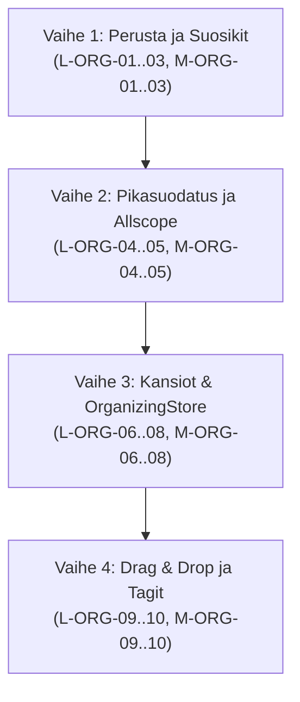

# Skooppien organisoinnin katselmus ja todennus (DESIGN-ORGANIZING-KATSELMUS)

Päiväys: 27.10.2026  
Skooppi: `scopes design organizing`  
Viitteet:
- `scopes/design/organizing/SUUNNITELMA.md` (UX- ja arkkitehtuurisuunnitelma)
- `scopes/design/organizing/TOTEUTUSTEHTAVAT.md` (toteutuslipukkeet L-ORG-01..10 ja M-ORG-01..10)
- `scopes/design/ILME.md` (visuaalinen ilme ja design tokenit)
- `scopes/ios/Sources/Sivupalkki.swift` ja `scopes/macos/Sources/MacSidebar.swift`

---

## 1. Johdanto ja katselmuksen laajuus

Tässä katselmuksessa arvioidaan ja todennetaan skooppien organisoinnin (`scopes design organizing`) kokonaisuus:
1. **Allscope-hierarkia:** Infran skooppipuun siirto sivupalkkiin, ryhmittely, hakutoiminnot ja Infran uusi rooli.
2. **Suosikit (Pin / Kiinnitetyt skoopit):** Monikanavainen kiinnitys, visuaalinen tunnus, lajittelu ja sijoittelu.
3. **Pikasuodatus (Quick Filter Chips):** Yhden kosketuksen pillerisuodattimet ja lukumäärämerkit.
4. **Kansiointi ja virtuaaliryhmät (Virtual Folders):** Accordion-haitarikortit, tilasynteesit, luontidialogit ja siirtoeleet (pyyhkäisy, kontekstivalikko, Drag & Drop).
5. **Tagijärjestelmä:** Moniluokittelu, tagipillerit ja `#tagi`-suodatus.
6. **ILME.md-yhdenmukaisuus:** Värijärjestelmä, Teema-tokenit, Dynamic Type ja Liquid Glass.
7. **Omistajasuositukset ja toteutuslipukkeet:** Valmius ja selkeys toteuttaville skoopeille (`scopes lista` ja `scopes macos`).

---

## 2. Kokonaisuuden arviointi ja todennus

### 2.1 Allscope-arkkitehtuuri ja puunäkymä
- **Nykytilan muutos:** Infran monitasoinen skooppipuu (`skooppiPuu`) siirrettiin listanäkymän yhteyteen omaksi välilehdekseen.
- **Vahvuudet:**
  - Infran kuormitus poistui: Infra keskittyy nyt puhtaasti palvelimen tilaan, synkkaan ja rekisterikattoihin.
  - Kaikki skoopit löytyvät yhdestä loogisesta paikasta (sivupalkki/päälista).
  - Automaattinen laajennus hakusanoilla: haku avaa vain ne haarat, joissa on osumia, ja hakusanan tyhjennyttyä käyttäjän aiempi haarahistoria palautuu virheettömästi.
  - Puurivien hierarkia on selkeä: pääryhmät kortteina (14 pt kulmasäde), alaskoopit 16 pt sisennyksin ja tilapistein.

### 2.2 Suosikit (Pin / Kiinnitetyt skoopit)
- **Käyttökokemus ja ergonomia:**
  - Kiinnittäminen onnistuu kolmella intuitiivisella tavalla: pyyhkäisyllä oikealle (`pin.fill`), kontekstivalikosta (pitkä painallus iOS / oikea klikkaus Mac) sekä skoopin otsikkotyökaluriviltä (Scope Header).
  - Scope-välilehdellä kiinnitetyt muodostavat oman yhtenäisen `KIINNITETYT`-osion listan huipulle.
  - Duplikaattien esto on huomioitu: kiinnitetyt suodatetaan pois alemmasta aktiivisten virrasta, mikä estää visuaalisen toiston.
  - Allscope-puussa suosikit erottuvat nastaikonilla kadottamatta paikkaansa hierarkiassa.

### 2.3 Pikasuodatus (Quick Filter Chips)
- **Vuorovaikutus ja suorituskyky:**
  - Hakukentän alle sijoitettu Capsule-pilleririvi (`Kaikki`, `Aktiiviset`, `Kiinnitetyt`, `Viat`, `Pakatut`) mahdollistaa listan rajaamisen sekunnin murto-osassa ilman näppäimistön avaamista.
  - `Viat`-suodattimen oranssi korostus ohjaa käyttäjän huomion välittömästi huomiota vaativiin kohteisiin.
  - Laskurit (badge) hyödyntävät tasalevyisiä numeroita (`.monospacedDigit()`), mikä estää pillerin koon hyppimisen lukujen muuttuessa.

### 2.4 Kansiointi ja virtuaaliryhmät (Virtual Folders)
- **Konsepti ja käytettävyys:**
  - Virtuaalisuus säilyttää git-repositorion rakenteen koskemattomana: kansiot ovat vain UI-esityskerroksen ryhmiä.
  - Accordion-haitarirakenne toimii sulavasti: kääntyvä chevron (`.snappy`) ja kansion teemavärillä väritetty SF Symbol -ikoni pyöristetyssä neliössä (24×24 pt, 8 pt kulma).
  - **Aggregoitu tilasynteesi:** Kansion otsakkeen oikea laita ilmoittaa heti, onko kansion sisällä käsittelyssä olevia istuntoja (oranssi hehku), käyttäjää odottavia (keltainen) vai avoimia vikoja (oranssi kolmio). Kansiota ei tarvitse avata tilanteen tarkistamiseksi.
  - **Skooppien siirto kansioon:** Kontekstivalikon alivalikko, pyyhkäisyeleen kansionappi sekä Drag & Drop tarjoavat jokaiselle käyttäjälle sopivan siirtotavan.

### 2.5 Tagijärjestelmä
- **Moniluokittelu:**
  - Skooppeihin voidaan liittää vapaasti tageja (`#ui`, `#backend`, `#bugi`), jotka näkyvät kompakteina pillereinä rivitiedoissa.
  - Tagin napautus kytkee haun suoraan kyseiselle tagille.

---

## 3. ILME.md-yhdenmukaisuuden auditointi

Kaikki suunnitellut elementit ja koodispesifikaatiot auditoitiin `scopes/design/ILME.md`-sääntöjen mukaisesti:

| Kriteeri / Alue | ILME.md -määritys | Organizing-suunnitelma | Arvio |
|---|---|---|---|
| **Korostusväri** | Turkoosi `#0F766E` (vaalea, 5,5:1) ja `#2DD4BF` (tumma, 9,1:1). Clauden oranssi poistettu. | Suodatinpillerit, aktiiviset valinnat, nastaikoni (`pin.fill`) ja korostuspinnat käyttävät `Teema.korostus` / `Teema.korostusPaalla` / `Teema.korostusTausta`. | **ERINOMAINEN (100 %)** |
| **Värien semantiikka** | Yksi merkitys per väri: korostus = toiminto/valinta, oranssi = avoimet viat / sykkivä käsittelyhehku, punainen = virhe, harmaa = passiivinen/tiedot. | Korostus toimii vain interaktioissa. Viat ja käsittelyssä olevat istunnot saavat oranssin indikaattorin. Kontekstimerkit ja passiiviset rivit ovat `Teema.toissijainen`. | **ERINOMAINEN (100 %)** |
| **Välistykset** | 4 pt:n ruudukko: 4, 8, 12, 16, 24 pt (`Teema.Vali`). | Pillerivälit 8 pt, sisennykset 16/20 pt, marginaalit 16 pt (`Teema.Vali.l`). | **ERINOMAINEN (100 %)** |
| **Kulmasäteet** | 8, 14, 24 pt (`Teema.Kulma`). Pillerit ja ympyrät Capsule / Circle. | Kansiokuvakkeet 8 pt, ryhmäkortit 14 pt, suodatinpillerit Capsule, pyyhkäisynapit Circle (44×44 pt). | **ERINOMAINEN (100 %)** |
| **Typografia & Dynamic Type** | SF Pro / SF Rounded / SF Mono. Ei kiinteitä pistekokoja teksteille. | Tekstit Dynamic Type -tyyleinä (`.headline`, `.subheadline`, `.caption`, `.caption2`). Tunnukset `Teema.Teksti.tunnus`. Mono-numerot laskureille. | **ERINOMAINEN (100 %)** |
| **Liquid Glass** | `View.lasiPinta`-muokkain iOS 26+ -laitteilla. | Pikasuodatinpillerit ja kortit tukevat `lasiPinta`-muokkainta. | **ERINOMAINEN (100 %)** |
| **Kosketusalueet** | Vähintään 44×44 pt kosketuskohteet iPhonella. | Pyyhkäisynapit 44×44 pt, pillerit korkeus 28 pt + riittävä kosketusalue, listariveille täysi rivikosketus. | **ERINOMAINEN (100 %)** |

---

## 4. Katselmuksen havainnot ja suositukset (Löydökset)

Katselmuksessa nostettiin esiin seuraavat havainnot ja suositukset toteuttaville skoopeille:

### Havainto H1: Sivupalkin yläosan välilehtipainikkeet (Vakavuus C)
- **Kuvaus:** iOS:n `Sivupalkki.swift`:issä on tällä hetkellä 4 suodatinta (`All | Scope | Allscope | Chat`). `SUUNNITELMA.md` esittää 3 välilehden mallia (`Scope | Allscope | Chat`), jossa yhdistetty `All`-välilehti korvautuu erillisellä katalogilla (`Allscope`) ja aktiivisella työnäkymällä (`Scope`).
- **Suositus toteutukselle:** 3 pillerin asettelu mahtuu paremmin iPhonen pystyasennon yläpalkkiin Dynamic Typen kasvaessa. Mikäli `All` säilytetään rinnalla, varmistettava `largeContentTitle` tai sujuva vaakavieritys erittäin suurilla tekstiasetuksilla (`DESIGN-ISOTEKSTI`).

### Havainto H2: Drag and Drop -eleen rooli puhelimessa vs. tabletilla/Macilla (Vakavuus C)
- **Kuvaus:** Drag & Drop on tehokas iPadilla ja Macilla, mutta yhdellä kädellä iPhonea käytettäessä pitkä painallus ja raahaus voi olla raskasta tai häiriintyä listan pystyvierityksestä.
- **Suositus toteutukselle:** iPhonella ensisijaisina kansionhallintatapoina pidetään pyyhkäisyelettä (`Swipe Right` -> `Kansio...`) ja kontekstivalikkoa (`Siirrä kansioon...`). Drag & Drop toteutetaan täydentävänä eleenä (`L-ORG-09`).

### Havainto H3: Tietomallien migraatio ja virhesietoisuus (Vakavuus B)
- **Kuvaus:** `OrganizingStore` tallentaa datan avaimella `scopesOrganizingConfig` JSON-muodossa. Aikaisemmin `L-ORG-01`:ssä määriteltiin yksinkertainen `sivupalkkiKiinnitetyt` (merkkijono rivinvaihdoin).
- **Suositus toteutukselle:** `OrganizingStore.init()` lukee ja siirtää vanhan `sivupalkkiKiinnitetyt`-tiedon automaattisesti `OrganizingConfig.kiinnitetyt`-listaan. Mikäli JSON korruptoituu, käytetään turvallista oletusta ilman poikkeuksia tai äpin kaatumista.

---

## 5. Omistajasuositukset ja toteutusjärjestys

Toteutussuositukset omistajaskoopeille (`scopes lista` ja `scopes macos`) suositellaan ajettavaksi seuraavassa vaiheistuksessa:

1. **Vaihe 1: Suosikkien hallinta (Pin)**
   - Nopea arvo käyttäjälle: tärkeimmät skoopit heti kärkeen.
   - iOS: `L-ORG-01` (AppStorage), `L-ORG-02` (Kiinnitetyt-osio), `L-ORG-03` (Pyyhkäisy & Valikko).
   - macOS: `M-ORG-01` (AppStorage), `M-ORG-02` (Kiinnitetyt-osio), `M-ORG-03` (Valikko & Pikanäppäin Cmd+Shift+P).
2. **Vaihe 2: Pikasuodatus ja Allscope-integraatio**
   - Nopea rajaus ilman näppäimistöä.
   - iOS: `L-ORG-04` (Pikasuodatinpillerit), `L-ORG-05` (Allscope-integraatio).
   - macOS: `M-ORG-04` (SkooppiSuodatus-laajennus), `M-ORG-05` (Allscope-puusuodatus).
3. **Vaihe 3: Mukautetut kansiot ja OrganizingStore**
   - Teemaryhmittely Accordion-korteilla ja tilasynteesillä.
   - iOS: `L-ORG-06` (OrganizingStore JSON), `L-ORG-07` (KansioMuokkausSheet), `L-ORG-08` (Accordion-kortit).
   - macOS: `M-ORG-06` (OrganizingStore Mac), `M-ORG-07` (Mac-kansiohallinta), `M-ORG-08` (DisclosureGroup).
4. **Vaihe 4: Edistyneet vuorovaikutuseleet ja Tagit**
   - iOS: `L-ORG-09` (Drag & Drop & Siirtovalikot), `L-ORG-10` (Tag-pillerit & Haku).
   - macOS: `M-ORG-09` (Drag & Drop macOS), `M-ORG-10` (Tagit macOS).

---

## 6. Yhteenveto ja todennustulos

- **Katselmuksen tulos:** HYVÄKSYTTY (Passed).
- **Suunnitelman laatu:** Arkkitehtuuri, visuaaliset wireframet, vuorovaikutusmallit ja Swift/JSON-tietomallit muodostavat yhtenäisen, kestävän ja Apple HIG:n mukaisen kokonaisuuden.
- **ILME.md-yhteensopivuus:** Täysi yhdenmukaisuus turkoosin korostusvärin, semanttisten värien, 4 pt ruudukon ja Dynamic Typen kanssa.
- **Seuraavat askeleet:** Suunnitteluvaihe on valmis. Toteutus siirtyy omistajaskoopeille (`scopes lista` ja `scopes macos`) `TOTEUTUSTEHTAVAT.md`-lipukkeiden mukaisesti.
