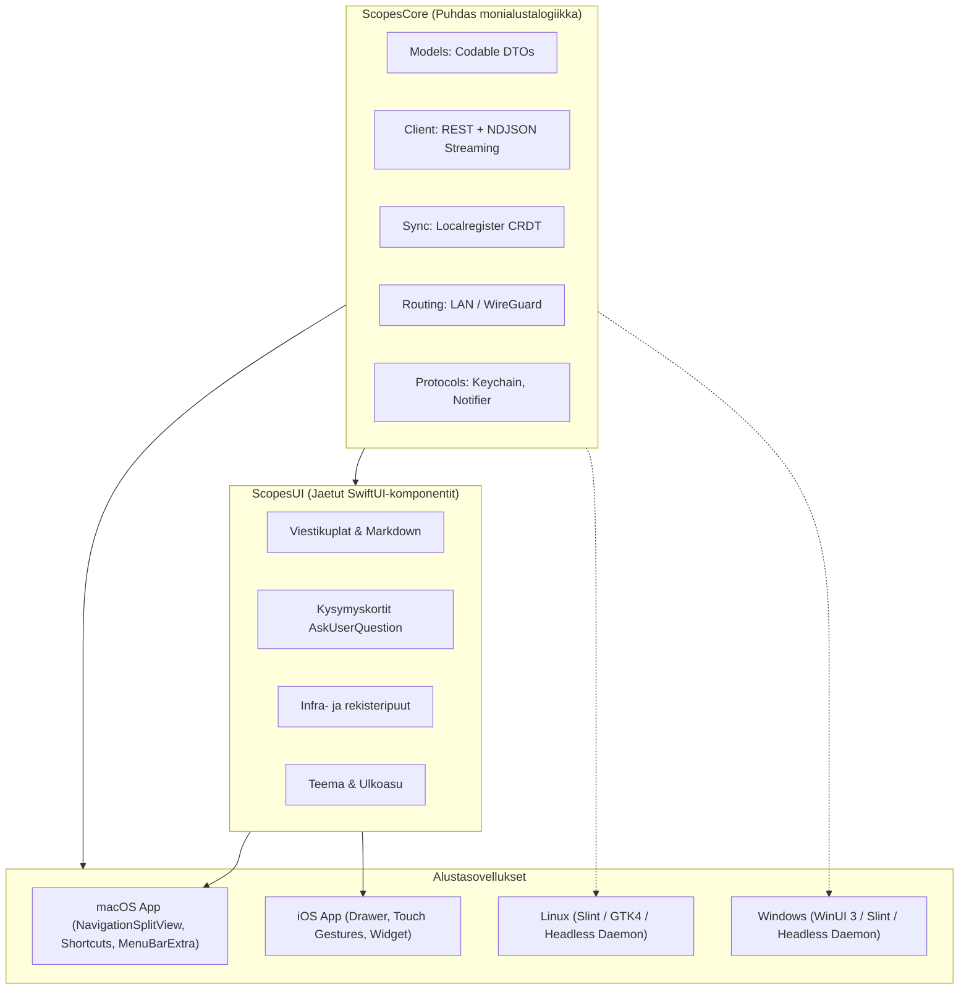

# Scopes: Natiivi macOS-äppi ja monialusta-arkkitehtuuri

## 1. Yhteenveto ja tavoitteet

Tämän suunnitelman tavoitteena on toteuttaa **Scopes-järjestelmälle natiivi macOS-työpöytäsovellus** (`scopes/macos`) siten, että:
1. **Monialustaisuus on sisäänrakennettu alusta alkaen:** macOS:n ja nykyisen iOS-äpin lisäksi rakenne mahdollistaa suoraviivaisen laajennuksen Linuxille ja Windowsille.
2. **Yhteinen koodi ei pirstaloidu:** Verkkokerros, tietomallit, NDJSON-suoratoisto, Localregister-CRDT ja tilalogiikka jaetaan keskitetysti. Kaikki korjaukset ja rajapintamuutokset heijastuvat välittömästi kaikille alustoille ilman rinnakkaiskoodin kopiointia.
3. **Natiivi alustalaatu:** macOS saa aidon työpöytäkäyttöliittymän (kolmesarakkeinen `NavigationSplitView`, fyysisen näppäimistön pikanäppäimet, macOS-työkalupalkin, valikkopalkki-integraation `MenuBarExtra` sekä tiedostojen Drag & Drop -tuen), eikä vain venytettyä mobiilinäkymää.
4. **Optimoitu Gemini Flash 3.8 Low (Lite) -toteutukselle:** Koko toteutus on pilkottu tiukan atomisiin, 80–120 rivin mikrotehtäviin, joissa on deterministinen yhden komennon verifiointiportti (`gate.sh`), eksplisiittiset tiedostorajat ja valmiit koodisopimukset ilman arkkitehtuuripäättelykuormaa.

---

## 2. Arkkitehtuuri: Jaettu Core & Natiivit Kuoret

### 2.1. Arkkitehtuurivalinta: Modular Swift Core & Shared UI

Arkkitehtuurianalyysin perusteella toteutetaan **modulaarinen Swift-monialustamalli**:



### 2.2. Hakemistorakenne

```text
scopes/
├── palvelu/                     # Node.js -taustapalvelin (REST, NDJSON, tmux)
├── localregister/               # Localregister-spesifikaatio ja protokolla
│
├── shared/                      # JAETUT SWIFT-PAKETIT (Swift Package Manager)
│   ├── ScopesCore/              # Alustariippumaton bisneslogiikka (macOS, iOS, Linux, Windows)
│   │   ├── Package.swift        # Kääntyy suoraan Swift 6:lla kaikilla alustoilla
│   │   └── Sources/ScopesCore/
│   │       ├── Models/          # Malli.swift (SkooppiYhteenveto, Viesti, Istunto jne.)
│   │       ├── Client/          # Asiakas.swift (REST, NDJSON-striimi, virheenkäsittely)
│   │       ├── Sync/            # Lr.swift (CRDT-synkka, vektorikellot, SHA-256 tiivisteet)
│   │       ├── Routing/         # ReittiCore.swift (LAN vs. WireGuard -reittilogiikka)
│   │       ├── Notifications/   # IlmoitusLaskenta.swift (Diffaus: tilasiirtymät, uudet viat)
│   │       ├── Diagnostics/     # DiagnostiikkaCore.swift (Vahti ja pyyntöloki)
│   │       └── Protocols/       # Alustakohtaiset abstraktiot:
│   │           ├── KeychainProvider.swift     # Avaimen tallennusrajapinta
│   │           └── NotificationCenter.swift   # Ilmoitusten lähetysrajapinta
│   │
│   └── ScopesUI/                # Jaetut SwiftUI-komponentit (macOS + iOS)
│       ├── Package.swift
│       └── Sources/ScopesUI/
│           ├── Theme/           # Teema.swift, Ulkoasu.swift (Värit, sävyt, typografia)
│           ├── Chat/            # Viestikupla.swift, KysymysKortti.swift
│           ├── Detail/          # SkooppiNakymaView.swift, KontekstiView.swift
│           ├── Infra/           # InfraPuuView.swift, RekisteritView.swift
│           └── SyncUI/          # LrNakymat.swift (Ristiriitojen ratkaisu, rivin muokkaus)
│
├── macos/                       # NATIIVI macOS-ÄPPI
│   ├── project.yml              # XcodeGen macOS -konfiguraatio
│   ├── gate.sh                  # Flash-agenttien deterministinen verifiointiportti
│   ├── Sources/
│   │   ├── ScopesMacApp.swift   # macOS @main, WindowGroup, Settings
│   │   ├── MacRootView.swift    # 3-sarakkeinen NavigationSplitView
│   │   ├── MacSidebar.swift     # macOS Source List & suodattimet
│   │   ├── MacToolbar.swift     # macOS-työkalupalkki (haku, stop/pura)
│   │   ├── MacChatInput.swift   # Enter = lähetä, Shift+Enter = uusi rivi
│   │   ├── MacCommands.swift    # Cmd+N, Cmd+K, Cmd+1..3, Esc
│   │   ├── MacMenuBar.swift     # MenuBarExtra: valikkopalkin tilannekuva
│   │   └── Platform/
│   │       ├── KeychainMac.swift       # macOS Keychain Services
│   │       ├── IlmoittajaMac.swift     # macOS UserNotifications
│   │       └── LiitteetMac.swift       # Drag & Drop Finderista, leikepöytä
│   └── Tests/
│
├── ios/                         # NATIIVI iOS-ÄPPI (nykyinen, refaktoroidaan käyttämään ScopesCorea)
│   ├── project.yml              # XcodeGen iOS -konfiguraatio
│   └── Sources/
│
└── desktop/                     # TULEVAISUUS: Linux & Windows
    ├── ScopesDaemon/            # C-ABI tai headless daemon ScopesCoresta
    ├── linux/                   # GTK4 / Slint -käyttöliittymä
    └── windows/                 # WinUI 3 / Slint -käyttöliittymä
```

---

## 3. Flash 3.8 Low (Lite) -toteutusohjeisto ja standardit

Flash 3.8 Low -mallien optimaalinen hyödyntäminen perustuu neljään sääntöön:

### Sääntö 1: Tehtävän atomisuus (Granularity Caps)
- **Koodirivien määrä:** Enintään **80–120 riviä** muutosta per tehtävä.
- **Tiedostokoko:** Lähdetiedostot pidetään alle **200 rivin**. Monimutkaiset näkymät pilkotaan alikomponenteiksi.
- **Sääntö 1+1:** Agentti muokkaa kerrallaan vain **yhtä lähdetiedostoa ja yhtä testitiedostoa**.

### Sääntö 2: Eksplisiittiset rajat (Strict File Fence)
Jokaisessa tehtävässä määritellään ehdottomat rajat:
- `may:` Tiedostot, joita saa muokata.
- `must not:` Kaikki muut tiedostot (build-asetukset, projektijuuri, git jne.).
- `read:` Täsmällinen tiedosto ja riviväli (esim. `ScopesCore/Models/Malli.swift:1-45`). Agentti ei tee yleistä hakemistotutkimusta.

### Sääntö 3: Verbatim-koodisopimus (No Architecture Guessing)
Tehtävänanto sisältää aina tarkan Swift-protokollan, struct-määrittelyn tai funktiosignatuurin, jota agentin on noudatettava kirjaimellisesti. Matalan päättelyn agentti ei arvaile rajapintoja.

### Sääntö 4: Yhden komennon verifiointiportti (`gate.sh`)
Agentti ei tee manuaalisia tarkistuksia tai arviointeja. Työ todennetaan komennolla:
```bash
bash scopes/macos/gate.sh <TEHTAVA_ID>
```
Portti ajaa:
1. Päättömät yksikkötestit (`swift test --filter ...` tai `xcodebuild test`).
2. Git-fencen: varmistaa, että vain `may:`-tiedostot ovat muuttuneet.
3. Palauttaa exit 0 (hyväksytty) tai virheilmoituksen.

---

## 4. Flash 3.8 Low -tehtäväsapluuna (Template)

Kaikki toteutusvaiheet syötetään agenteille seuraavassa muodossa:

````markdown
# TASK: [TEHTÄVÄN-TUNNUS] — [Kuvaus, max 60 merkkiä]

## Task
[Yksi selkeä imperatiivinen lause: mitä koodataan tai korjataan.]

## Files
may: [Polku_1], [Polku_2]
must not: [Kaikki muut tiedostot, build-asetukset, projektin juuri, .git]
read: [Tarkka polku ja riviväli, esim: scopes/shared/ScopesCore/Sources/ScopesCore/Models/Malli.swift:1-45]

## Contract
Noudata täsmällisesti seuraavaa rajapintaa ja tyyppejä:
```swift
// [Täsmällinen koodisopimus / protocol / struct]
```

## Do
1. [Askel 1: Luo / muokkaa tiedostoa may-listalta]
2. [Askel 2: Toteuta määrätty toiminnallisuus Contract-osion mukaisesti]
3. [Askel 3: Lisää / päivitä yksikkötesti]
4. Älä tee mitään muutoksia 'may'-listan ulkopuolelle.

## Acceptance
Aja seuraava komento todentaaksesi työn:
```bash
bash scopes/macos/gate.sh [TEHTÄVÄN-TUNNUS]
```
Kriteeri: Exit code 0, testit läpi, git-puussa vain sallitut muutokset.
````

---

## 5. Vaiheistettu toteutussuunnitelma (Sprints 1–7)

### Vaihe 1: `ScopesCore` – Yhteinen monialustaydin
- [x] **CORE-01**: `shared/ScopesCore/Package.swift` alustus (Swift 6, Foundation, Swift-Crypto).
- [x] **CORE-02**: `Malli.swift` siirto ja vakiointi puhtaaksi `ScopesCore/Models`-moduuliksi + JSON-dekoodaustestit.
- [x] **CORE-03**: `Asiakas.swift` refaktorointi puhtaaksi `ScopesCore/Client`-moduuliksi (URLSession, ilman UIKit-riippuvuuksia) + mock-testit.
- [x] **CORE-04**: NDJSON-striimausasiakas (`AsyncThrowingStream`) + yksikkötesti.
- [x] **CORE-05**: `Lr.swift` siirto `ScopesCore/Sync`-moduuliksi (CRDT, vektorikellot, SHA-256) + synkkatestit.
- [x] **CORE-06**: Alustaprotokollien määrittely (`KeychainProvider`, `NotificationCenter`).

### Vaihe 2: macOS-kehys ja testausportti (`scopes/macos`)
- [x] **MAC-01**: `scopes/macos/project.yml` (XcodeGen macOS -targetti, linkitys `ScopesCoreen`).
- [x] **MAC-02**: `scopes/macos/gate.sh` -verifiointiskriptin toteutus.
- [x] **MAC-03**: `MacKeychain.swift` (macOS Keychain Services -sovitin).
- [x] **MAC-04**: `ScopesMacApp.swift` perusrunko ja ikkuna-asetukset.

### Vaihe 3: macOS Käyttöliittymärunko & Sivupalkki
- [x] **MAC-05**: `MacRootView.swift` 3-sarakkeinen `NavigationSplitView`.
- [x] **MAC-06**: `MacSidebar.swift` skooppilista tilamerkeillä (vihreä, keltainen, oranssi).
- [x] **MAC-07**: Sivupalkin tilasuodatus (Kaikki / Aktiiviset / Odottaa / Pakattu).
- [x] **MAC-08**: Hiiren oikean napin kontekstivalikko (Pura, Pakkaa, Stop).

### Vaihe 4: macOS Chat & Viestinvälitys
- [x] **MAC-09**: `shared/ScopesUI` alustus (siirretään `Viestikupla.swift` ja markdown-renderöinti).
- [x] **MAC-10**: `MacChatInput.swift` työpöytäsyöterivi (Enter lähettää, Shift+Enter rivinvaihto).
- [x] **MAC-11**: `MacQuestionCard.swift` (natiivi kortti `AskUserQuestion`-monivalinnoille).
- [x] **MAC-12**: Mallivalitsin ja käyttörajapalkki macOS-työkalupalkkiin.

### Vaihe 5: macOS Inspektori & Rekisterinäkymät
- [x] **MAC-13**: `MacInspectorView.swift` (seuraava paketti, avoimet asiat, viat).
- [x] **MAC-14**: `REKISTERI.md`-katselin ja osioiden pikasiirtymät.
- [x] **MAC-15**: Toimintopalkki (Pura, Pakkaa, Automaattisiirto).

### Vaihe 6: Natiivit työpöytäominaisuudet
- [x] **MAC-16**: `MacMenuBar.swift` (`MenuBarExtra` ambient-tilannekuva Macin valikkopalkissa).
- [x] **MAC-17**: Tiedostojen Drag & Drop -pudotustuki Finderista viestikenttään.
- [x] **MAC-18**: macOS-näppäinoikotiet (`Cmd+N`, `Cmd+K`, `Cmd+1..3`, `Esc`).

### Vaihe 7: Monialustalaajennus ja yhtenäistäminen
- [ ] **MULTI-01** (laajennettu: ARK-08, odottaa ARK-06 ja ARK-07): `scopes/ios` linkitys käyttämään jaettua `ScopesCore`-pakettia ja iOS-regressiotestaus (`testi.sh`).
- [-] **MULTI-02** (korvattu K-4:llä 19.10.2026): Linux-käännöksen validointi `swift build` -komennolla Linux-ympäristössä.
- [-] **MULTI-03** (korvattu K-4:llä 19.10.2026): Windows Swift Toolchain -yhteensopivuustarkistus `ScopesCore`-tasolla.

---

## 6. Päivitysehdotus: `scopes/macos/REKISTERI.md`

Kun suunnitelma hyväksytään, `scopes/macos/REKISTERI.md` päivitetään seuraavasti:

```markdown
# scopes/macos/REKISTERI.md

Tilanne: 17.10.2026

SEURAAVA PAKETTI: MACOS-RUNKO-JA-CORE — luo shared/ScopesCore-paketti ja scopes/macos-perusrunko porttiverifioinnilla — polut: scopes/shared/ScopesCore/**, scopes/macos/** — aloitus: /pura scopes macos

## Tarkoitus ja raja

Tarkoitus: Natiivi macOS-työpöytäsovellus Scopes-infran ja Claude/AGY-istuntojen hallintaan ja viestintään. Rakenne on monialustainen siten, että jaettu bisneslogiikka (verkkorajapinta, NDJSON-suoratoisto, CRDT-rekisterisynkka ja mallit) eristetään jaettuun ScopesCore-pakettiin, jota käyttävät macOS ja iOS sekä myöhemmin Linux ja Windows.
Raja: Polut `scopes/macos/**` ja `scopes/shared/**`. Ei kata AGY-spesifisiä macos-integraatioita (kuuluvat `scopes agy macos` -skoopille) eikä palvelimen taustakoodia (kuuluvat `scopes yhteys` / `scopes palvelu`).

## Päätökset

- **Käyttäjä 17.10.2026:** Skoopin tarkoitus on tehdä natiivi macOS-äppi. Kehityksessä huomioidaan tuleva laajennus iOS:n lisäksi Linuxille ja Windowsille. Korjausten integrointi, jatkokehitys ja rakenteen muutokset kaikille alustoille keskitetään jaettuun ytimeen ilman pirstaloitumista.
- **Käyttäjä 17.10.2026:** Suunnitelman toteutus optimoidaan Gemini Flash 3.8 Low (Lite) -agenttien ajettavaksi atomisilla tehtävillä ja porttiverifioinnilla.
```
