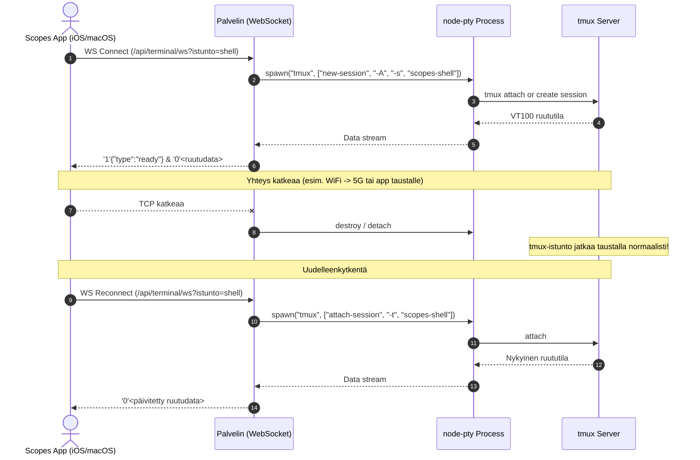

# scopes/remoteterminal — Rajapintasopimus ja protokollamääritys

**Päivitetty:** 27.10.2026  
**Tila:** Hyväksytty määritys (REMOTETERMINAL-SUUNNITTELU)  
**Skooppi:** `scopes remoteterminal`  
**Viitepolut:** `scopes/remoteterminal/**`, `scopes/palvelu/**`, `scopes2/shared/**`

---

## 1. Johdanto

Tämä dokumentti määrittelee Scopes Etäterminaalin (Remote Terminal) täsmällisen rajapintasopimuksen:
1. **REST-rajapinta:** Istuntojen luonti, luettelointi, tilakyselyt ja päättäminen.
2. **WebSocket-protokolla:** Reaaliaikainen PTY-kaksisuuntainen tietovirta ja ohjausviestit (resize, ping, signal).
3. **Tmux-kytkentämalli:** Palvelinpään prosessien ja tmux-istuntojen elinkaari, irrotus (detach) ja liitos (attach).
4. **Viestiskeemat:** JSON-skeemat ja Swift Codable -mallit.
5. **Asiakasintegraatio:** `SwiftTerm`-päätteen kytkentä ja mobiililisäpalkin toiminnot.

---

## 2. REST-rajapinta

Kaikki REST-pyynnöt vaativat otsakkeen:
```http
Authorization: Bearer <SCOPES_AVAIN>
Content-Type: application/json
```

### 2.1. Istuntojen listaus: `GET /api/terminal/sessions`

Palauttaa palvelimella olevat aktiiviset terminaali-istunnot ja tunnetut tmux-istunnot.

**Vastaus (200 OK):**
```json
{
  "ok": true,
  "sessions": [
    {
      "id": "term-20261027-094500-a1b2",
      "name": "scopes-shell",
      "type": "tmux",
      "tmuxSession": "scopes-shell",
      "command": "/bin/zsh",
      "cwd": "~/sessions-repo",
      "cols": 120,
      "rows": 36,
      "attachedClients": 1,
      "createdAt": "2026-10-27T09:45:00.000Z",
      "lastActiveAt": "2026-10-27T09:46:12.000Z"
    }
  ]
}
```

### 2.2. Uuden istunnon luonti: `POST /api/terminal/sessions`

Luo uuden terminaali-istunnon tai kytkeytyy olemassa olevaan tmux-istuntoon.

**Pyyntörunko (JSON):**
```json
{
  "name": "kehitys",
  "command": "/bin/zsh",
  "args": ["-l"],
  "cwd": "~/sessions-repo",
  "cols": 120,
  "rows": 36,
  "tmuxSession": "scopes-kehitys",
  "env": {
    "TERM": "xterm-256color"
  }
}
```
*Kenttien valinnaisuus:*
- `name`: Valinnainen lempinimi (oletus `"terminal"`).
- `command`: Valinnainen (oletus käyttäjän oletusshell `$SHELL` tai `/bin/zsh` / `/bin/bash`).
- `args`: Valinnainen argumenttilista.
- `cwd`: Valinnainen työhakemisto (oletus `SCOPES_JUURI` tai käyttäjän kotihakemisto).
- `cols`: Valinnainen sarakesuuruus (oletus 80, sallittu 20–500).
- `rows`: Valinnainen rivisuuruus (oletus 24, sallittu 5–200).
- `tmuxSession`: Valinnainen tmux-istunnon nimi. Jos määritelty, kytkeydytään tmuxiin (`tmux new-session -A -s <tmuxSession>`). Jos tyhjä, luodaan automaattisesti nimetty tmux-istunto `scopes-term-<id>`.

**Vastaus (201 Created):**
```json
{
  "ok": true,
  "session": {
    "id": "term-20261027-094500-a1b2",
    "name": "kehitys",
    "tmuxSession": "scopes-kehitys",
    "cols": 120,
    "rows": 36,
    "wsPath": "/api/terminal/ws?istunto=term-20261027-094500-a1b2"
  }
}
```

### 2.3. Istunnon tietojen haku: `GET /api/terminal/sessions/:id`

Hakee yhden terminaali-istunnon tarkat tiedot.

**Vastaus (200 OK):**
```json
{
  "ok": true,
  "session": {
    "id": "term-20261027-094500-a1b2",
    "name": "kehitys",
    "tmuxSession": "scopes-kehitys",
    "cols": 120,
    "rows": 36,
    "attachedClients": 1,
    "pid": 48210,
    "createdAt": "2026-10-27T09:45:00.000Z"
  }
}
```
Jos istuntoa ei löydy: `404 Not Found` `{ "ok": false, "error": "Istuntoa ei löydy" }`.

### 2.4. Istunnon sulkeminen: `DELETE /api/terminal/sessions/:id`

Sulkee PTY-yhteyden. Valinnaisella parametrilla `?killTmux=true` myös tmux-istunto tapetaan.

**Pyyntö:** `DELETE /api/terminal/sessions/term-20261027-094500-a1b2?killTmux=false`

**Vastaus (200 OK):**
```json
{
  "ok": true,
  "closed": "term-20261027-094500-a1b2",
  "tmuxKilled": false
}
```

---

## 3. WebSocket-protokolla ja viestikehykset

### 3.1. Kättely (Handshake)

- **Osoite:** `/api/terminal/ws?istunto=<id>&cols=<n>&rows=<n>`
- **Autentikointi:**
  1. Ensisijainen: HTTP Upgrade -pyynnön otsake:
     `Authorization: Bearer <SCOPES_AVAIN>`
  2. Toissijainen (asiakkaille, jotka eivät tue custom-otsakkeita kättelyssä):
     URL-parametri: `?token=<SCOPES_AVAIN>`
- Palvelin tarkistaa Bearer-avaimen turvallisesti vakioaikaisella vertailulla (`crypto.timingSafeEqual`). Jos avain on virheellinen, kättely hylätään HTTP-statuksella `401 Unauthorized`.

### 3.2. Kehysformaatti ja kanavointi (Framing Specification)

Suorituskyvyn maksimoimiseksi ja JSON-parsimisen ylimääräisen kuorman välttämiseksi terminaalin raakadatalle käytetään determinististä 1-tavuista kanavatunnusta viestin alussa:

```
+----------------+----------------------------------------------------+
| 1 tavu (Kanava)| Kuorma (Payload)                                   |
+----------------+----------------------------------------------------+
| '0' (0x30)     | Raaka PTY I/O -data (UTF-8 teksti tai binääri)     |
| '1' (0x31)     | JSON-ohjausviesti (Control Frame)                  |
| '2' (0x32)     | Heartbeat Ping / Pong                              |
+----------------+----------------------------------------------------+
```

#### Kanava `'0'` — Raaka PTY I/O Data:
- **Asiakkaalta palvelimelle:** Käyttäjän näppäinsyöte ja ANSI-escape-koodit. Esimerkki:
  `0ls -la\r`
- **Palvelimelta asiakkaalle:** PTY:n tuottama raakatuloste värikoodeineen ja kursoriasemointeineen. Asiakas syöttää datan sellaisenaan `SwiftTerm.TerminalView`-komponentille: `terminalView.feed(byteArray)`.

#### Kanava `'1'` — JSON-ohjausviestit:
Ohjausviestit kulkevat muodossa `'1' + JSON.stringify(obj)`.

1. **Ikkunan koon muutos (`resize`):**
   Lähetetään asiakkaalta, kun terminaalinäkymän koko muuttuu (esim. laitteen kääntö vaakatilaan tai fonttikoon muutos):
   ```json
   {
     "type": "resize",
     "cols": 120,
     "rows": 36
   }
   ```
   Palvelin kutsuu välittömästi `ptyProcess.resize(cols, rows)` ja välittää `SIGWINCH`-signaalin.

2. **Signaalin lähetys (`signal`):**
   Lähetetään esim. pikanäppäinpalkin keskeytysnapista:
   ```json
   {
     "type": "signal",
     "signal": "SIGINT"
   }
   ```
   Tuetut signaalit: `SIGINT`, `SIGTERM`, `SIGKILL`, `SIGWINCH`.

3. **Palvelimen tilailmoitus (`ready` / `exit` / `error`):**
   Palvelin lähettää kättelyn jälkeen:
   ```json
   {
     "type": "ready",
     "sessionId": "term-20261027-094500-a1b2",
     "tmuxSession": "scopes-shell",
     "cols": 120,
     "rows": 36
   }
   ```
   Prosessin päättyessä:
   ```json
   {
     "type": "exit",
     "exitCode": 0,
     "signal": null
   }
   ```
   Virhetilanteessa:
   ```json
   {
     "type": "error",
     "message": "PTY-prosessin luonti epäonnistui"
   }
   ```

#### Kanava `'2'` — Heartbeat Ping / Pong:
- Asiakas voi lähettää `'2'` 15 sekunnin välein yhteyden elossapidon varmistamiseksi. Palvelin vastaa välittömästi `'2'`.
- Jos viestiin ei saada vastausta 30 sekuntiin, yhteys tulkitaan katkenneeksi ja asiakas käynnistää automaattisen uudelleenyhdistyksen.

---

## 4. Tmux-kytkentämalli ja elinkaari

Etäterminaali noudattaa tiukkaa **Tmux-ensimmäisyyttä**:



### 4.1. Tmux-istuntojen parametrit
- Komento: `tmux new-session -A -s <istuntonimi> -c <hakemisto> <komento>`
  - `-A`: Liity olemassa olevaan, jos se on jo luotu; älä heitä virhettä.
  - `-s <istuntonimi>`: Tunnistettava nimi (esim. `scopes-term-1` tai olemassa oleva agenttisessio).
  - `-c <hakemisto>`: Oletustyöhakemisto.
- Ikkunakoon hallinta: tmux asetetaan huomioimaan aktiivisen pääteikkunan koko:
  `tmux set-window-option -g window-size latest`
  Tällöin uusin yhdistänyt mobiili- tai Mac-laite määrää ikkunan leveyden ja korkeuden.

---

## 5. Swift-asiakasintegraation sopimus

### 5.1. Swift Codable -mallit

```swift
import Foundation

public struct TerminalSessionInfo: Codable, Identifiable, Sendable {
    public let id: String
    public let name: String
    public let type: String
    public let tmuxSession: String?
    public let command: String?
    public let cwd: String?
    public let cols: Int
    public let rows: Int
    public let attachedClients: Int
    public let createdAt: String
    public let lastActiveAt: String?
}

public struct CreateTerminalSessionRequest: Codable, Sendable {
    public let name: String?
    public let command: String?
    public let args: [String]?
    public let cwd: String?
    public let cols: Int?
    public let rows: Int?
    public let tmuxSession: String?
    
    public init(name: String? = nil, command: String? = nil, args: [String]? = nil,
                cwd: String? = nil, cols: Int? = 80, rows: Int? = 24, tmuxSession: String? = nil) {
        self.name = name
        self.command = command
        self.args = args
        self.cwd = cwd
        self.cols = cols
        self.rows = rows
        self.tmuxSession = tmuxSession
    }
}

public enum TerminalControlMessage: Codable, Sendable {
    case resize(cols: Int, rows: Int)
    case signal(String)
    case ready(sessionId: String, tmuxSession: String?, cols: Int, rows: Int)
    case exit(exitCode: Int?, signal: String?)
    case error(message: String)
    
    private enum CodingKeys: String, CodingKey {
        case type, cols, rows, signal, sessionId, tmuxSession, exitCode, message
    }
    
    public init(from decoder: Decoder) throws {
        let container = try decoder.container(keyedBy: CodingKeys.self)
        let type = try container.decode(String.self, forKey: .type)
        switch type {
        case "resize":
            let cols = try container.decode(Int.self, forKey: .cols)
            let rows = try container.decode(Int.self, forKey: .rows)
            self = .resize(cols: cols, rows: rows)
        case "signal":
            let sig = try container.decode(String.self, forKey: .signal)
            self = .signal(sig)
        case "ready":
            let sId = try container.decode(String.self, forKey: .sessionId)
            let tmux = try container.decodeIfPresent(String.self, forKey: .tmuxSession)
            let cols = try container.decode(Int.self, forKey: .cols)
            let rows = try container.decode(Int.self, forKey: .rows)
            self = .ready(sessionId: sId, tmuxSession: tmux, cols: cols, rows: rows)
        case "exit":
            let code = try container.decodeIfPresent(Int.self, forKey: .exitCode)
            let sig = try container.decodeIfPresent(String.self, forKey: .signal)
            self = .exit(exitCode: code, signal: sig)
        case "error":
            let msg = try container.decode(String.self, forKey: .message)
            self = .error(message: msg)
        default:
            throw DecodingError.dataCorruptedError(forKey: .type, in: container, debugDescription: "Tuntematon viestityyppi: \(type)")
        }
    }
    
    public func encode(to encoder: Encoder) throws {
        var container = encoder.container(keyedBy: CodingKeys.self)
        switch self {
        case .resize(let cols, let rows):
            try container.encode("resize", forKey: .type)
            try container.encode(cols, forKey: .cols)
            try container.encode(rows, forKey: .rows)
        case .signal(let sig):
            try container.encode("signal", forKey: .type)
            try container.encode(sig, forKey: .signal)
        case .ready(let sId, let tmux, let cols, let rows):
            try container.encode("ready", forKey: .type)
            try container.encode(sId, forKey: .sessionId)
            try container.encodeIfPresent(tmux, forKey: .tmuxSession)
            try container.encode(cols, forKey: .cols)
            try container.encode(rows, forKey: .rows)
        case .exit(let code, let sig):
            try container.encode("exit", forKey: .type)
            try container.encodeIfPresent(code, forKey: .exitCode)
            try container.encodeIfPresent(sig, forKey: .signal)
        case .error(let msg):
            try container.encode("error", forKey: .type)
            try container.encode(msg, forKey: .message)
        }
    }
}
```

### 5.2. Kehysten koodaus ja purku (Wire Protocol Helpers)

```swift
public struct TerminalWireFrame {
    public static func encodeData(_ text: String) -> String {
        return "0" + text
    }
    
    public static func encodeData(_ bytes: Data) -> Data {
        var d = Data([0x30]) // ASCII '0'
        d.append(bytes)
        return d
    }
    
    public static func encodeControl(_ message: TerminalControlMessage) throws -> String {
        let json = try JSONEncoder().encode(message)
        let str = String(decoding: json, as: UTF8.self)
        return "1" + str
    }
    
    public static func ping() -> String {
        return "2"
    }
}
```

### 5.3. SwiftTerm Delegate -kytkentä

`SwiftTerm.TerminalViewDelegate` tarjoaa suorat metodit syötteelle ja koon muutokselle:
1. `send(source: TerminalView, data: ArraySlice<UInt8>)`:
   Muunnetaan `Data`-muotoon ja lähetetään WebSocketiin kanavatunnuksella `'0'`.
2. `sizeChanged(source: TerminalView, newCols: Int, newRows: Int)`:
   Lähetetään WebSocketiin kanavatunnuksella `'1'` viesti `.resize(cols: newCols, rows: newRows)`.
3. Saapuva WebSocket-viesti kanavalla `'0'`:
   Kutsutaan `terminalView.feed(byteArray: [UInt8](payload))`.

---

## 6. Mobiilin pikanäppäinpalkki (Accessory Toolbar)

Mobiilinäppäimistön yläpuolelle kiinnitettävä palkki sisältää seuraavat toiminnot:

| Painike | Lähetettävä sekvenssi / Vaikutus | Kuvaus |
|---|---|---|
| **`ESC`** | `\u{1B}` | Escape-näppäin (vim, cancel, fzf) |
| **`TAB`** | `\t` (0x09) | Autocompletion komentorivillä |
| **`CTRL`** | Sticky Modifier | Lukittuu päälle seuraavan näppäinpainalluksen ajaksi |
| **`ALT`** | Sticky Modifier | Lukittuu päälle seuraavan näppäimen ajaksi (Meta-avain) |
| **`▲`** | `\u{1B}[A` | Edellinen komento historiasta |
| **`▼`** | `\u{1B}[B` | Seuraava komento historiasta |
| **`◀`** | `\u{1B}[D` | Kursori vasemmalle |
| **`▶`** | `\u{1B}[C` | Kursori oikealle |
| **`Ctrl-C`** | `\u{03}` | Keskeytyssignaali |
| **`Ctrl-D`** | `\u{04}` | EOF / Logout |
| **`Ctrl-L`** | `\u{0C}` | Ruudun tyhjennys ja uudelleenpiirto |

Kun `CTRL` on aktivoituna mobiilissa ja käyttäjä painaa `C`, lähetetään byte `0x03` (`Ctrl-C`) ja `CTRL`-tila vapautuu automaattisesti.

---

## 7. Yhteenveto ja siirtymä toteutusvaiheeseen

Tämä rajapintasopimus kattaa täydellisesti:
- REST-hallintapäätepisteet
- 1-tavuisen vikasietoisen ja korkean suorituskyvyn WebSocket-kehysprotokollan
- Tmux-kytkennän elinkaaren
- SwiftTerm- ja SwiftUI-mallit sekä mobiilipikanäppäinpalkin logiikan.

Seuraava toteutusvaihe on `REMOTETERMINAL-PALVELU`, jossa toteutetaan palvelinpään moduulit `scopes/palvelu/terminal.mjs` ja `scopes/palvelu/terminal.test.mjs`.
