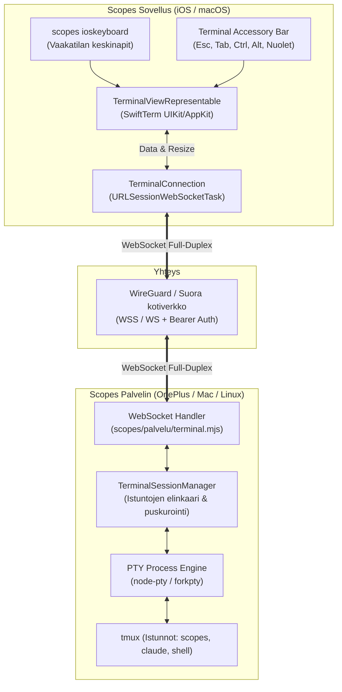
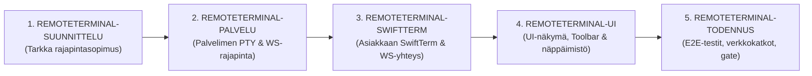

# scopes/remoteterminal: Arkkitehtuurikartoitus ja toteutussuunnitelma

**Päivitetty:** 27.10.2026 (REMOTETERMINAL-SUUNNITTELU)  
**Tila:** Rajapintasopimus, kehysprotokolla ja toteutussuunnitelma valmis  
**Skooppi:** `scopes remoteterminal`  
**Viitepolut:** `scopes/remoteterminal/**`, `scopes/palvelu/**`, `scopes2/shared/**`, `scopes/ioskeyboard/**`

---

## 1. Johdanto ja tavoitteet

Scopes-ekosysteemi tarjoaa komentotila-, chat- ja kehitystyökalujen hallinnan usealla laitteella (OnePlus-palvelin, Mac, palvelin, iPhone ja iPad). Tähän asti komentojen suoritus ja istuntojen valvonta on tapahtunut joko epäsuorasti transkriptien lukemisen ja tekstiviestien lähettämisen kautta (`POST /api/skoopit/<nimi>/viesti`, `tmux send-keys`) tai etänä erillisten SSH-työkalujen avulla.

**Etäterminaalin (Remote Terminal)** tavoitteena on tuoda täysin vuorovaikutteinen, reaaliaikainen PTY-terminaali suoraan Scopes-käyttöliittymään (iOS ja macOS) hyödyntäen nykyistä palvelininfrastruktuuria (`scopes/palvelu` ja `scopes2`).

### Keskeiset käyttötapaukset:
1. **Reaaliaikainen tmux- ja agentti-istuntojen seuranta ja ohjaus:** Mahdollisuus avata suora terminaaliyhteys olemassa oleviin tmux-istuntoihin (esim. Claude Code-, Agy- tai kehityssessioihin) ja nähdä reaaliaikainen curses/ANSI-ruutu.
2. **Interaktiivinen komentotulkki (Shell):** Suora pääsy zsh/bash-shelliin palvelimella suoraan puhelimesta tai Mac-äpistä ilman tarvetta ulkoisille SSH-sovelluksille.
3. **Mobiilioptimointi:** Täysi hyöty `scopes ioskeyboard` -näppäimistön vaakatilan koodausnapeista ja terminaalispesifistä pikanäppäinpalkista (Ctrl, Esc, Tab, nuolet).
4. **Katkeamattomuus:** Istunnot pyörivät palvelinpäässä (tmuxin alla), jolloin verkkokatkot, sovelluksen taustalle siirtyminen tai laitteen vaihto eivät tapa ajettavia komentoja.

---

## 2. Arkkitehtuurivaihtoehtojen kartoitus ja vertailu

### 2.1. PTY ja taustaprosessit palvelimella

Interaktiivinen terminaali vaatii näennäispäätteen (pseudoterminal, PTY). Ilman PTY:tä ohjelmat (`ssh`, `vim`, `htop`, `tmux`, `git commit`, `fzf`) havaitsevat, että tulostus ei ole pääte (`isatty() == false`), jolloin ne poistavat värityksen, kieltäytyvät curses-tilasta tai puskuroivat rivinsä.

| Vaihtoehto | Kuvaus | Hyvät puolet | Haasteet / Rajoitteet | Soveltuvuus Scopesiin |
|---|---|---|---|---|
| **A. `node-pty`** (Node.js) | C++ -natiivisidokset POSIX `openpty`/`forkpty` -rajapintoihin. | Teollisuusstandardi (VS Code, Hyper, ttyd). Täysi VT100/xterm, termios, SIGWINCH-kokoasetukset. | Vaatii `node-gyp` -kääntämisen. Termuxissa (OnePlus) vaatii C++-kääntäjän, mikä voi olla hauras. Mac/Linux toimii vaivattomasti. | **Ensisijainen Node-palveluun** Macilla ja Linuxilla; fallback tarvitaan Termuxiin. |
| **B. Puhdas `child_process.spawn`** | Node.js:n vakio subprocess-putket (stdin/stdout/stderr). | Ei ulkoisia riippuvuuksia, kääntyy ja toimii kaikkialla. | **Ei ole PTY.** `isatty() == false`. Curses/TUI (tmux, vim, htop) ei toimi kunnolla. | Ei sovellu vuorovaikutteiseksi päätteeksi sellaisenaan. |
| **C. `tmux attach` PTY:n läpi** | PTY luodaan ja se liitetään tmux-istuntoon: `tmux attach-session -t <nimi>`. | Istunnot eivät kuole yhteyden katketessa. Yhdistää saumattomasti Scopesin olemassa oleviin tmux-prosesseihin. | Vaatii toimivan PTY-alustan (vaihtoehto A tai D). | **Arkkitehtuurin ydinmalli**: kaikki pääteistunnot sidotaan tmuxiin. |
| **D. Rust `portable-pty`** | Natiivi Rust-kirjasto PTY-hallintaan `scopes2/ydin` -ytimessä. | Turvallinen, nopea, staattisesti linkittyvä ilman C++-build-työkaluja. Täysi POSIX/Windows-tuki. | Vaatii toteutuksen Rust-ytimeen (`scopes2/ydin`). | **Tulevaisuuden ratkaisu** Scopes V2 -solmuytimelle. |

#### PTY-johtopäätös ja strategia:
Palvelinpäässä käytetään kaksitasoista strategiaa:
1. **Scopes V1 (`scopes/palvelu`):** Hyödynnetään `node-pty` -kirjastoa. Mikäli ympäristössä ei ole C++-kääntäjää (kuten tietyt Termux-asennukset), tarjotaan kevyt tmux-ohjauskomentorivifallback tai PTY-apuprosessi.
2. **Tmux-ensimmäisyys:** Jokainen avattu etäterminaali kytketään oletuksena tmux-istuntoon (`tmux new-session -A -s <istunto>`), jolloin istunto säilyy palvelimella riippumatta verkkotilasta.

---

### 2.2. Protokolla ja siirtotie (WebSocket vs HTTP SSE)

Terminaalin tiedonsiirto edellyttää pientä latenssia, molemminpuolista viestintää (full-duplex) ja ohjausviestien (ikkunan koon muutos, signaalit) välitystä.

```
+-----------------------------------------------------------------------------------+
| VAIHTOEHTOVERTAILU: WebSocket vs HTTP SSE + POST                                 |
+-----------------------------------------------------------------------------------+
| Ominaisuus          | WebSocket (RFC 6455)         | HTTP SSE (Virta) + POST     |
+---------------------+------------------------------+------------------------------+
| Yhteysmalli         | Yksi pysyvä kaksisuuntainen  | SSE alaspäin, POST ylöspäin  |
| Latenssi            | Minimaalinen (~1-5 ms)       | POST-kättely lisää latenssia |
| Kehyskulu (overhead)| 2–10 tavua per paketti       | Sadat tavut (HTTP-otsakkeet) |
| Näppäinkohtainen I/O| Saumaton, reaaliaikainen     | Raskas ja pätkivä mobiilissa |
| Swift-tuki          | Natiivi URLSessionWebSocket  | URLSession-virta + URLSession|
| Ikkunamuutokset     | JSON-ohjauskehys samassa WS  | Erillinen POST /resize       |
| Turvallisuus        | Bearer-token kättelyssä / WG | Bearer-token joka pyynnössä  |
+---------------------+------------------------------+------------------------------+
```

#### Protokollajohtopäätös:
- **WebSocket** on ehdoton ja teollisuuden yleisesti hyväksymä standardi terminaaliyhteyksille.
- Swiftin `URLSessionWebSocketTask` tukee suoraan WebSocket-yhteyttä iOS:llä ja macOS:llä ilman kolmannen osapuolen kirjastoja.
- Yhteys kätellään osoitteessa:
  `ws[s]://<isäntä>:<portti>/api/terminal/ws?istunto=<tunnus>`
  Otsakkeena lähetetään Scopesin tuttu `Authorization: Bearer <avain>`.

---

### 2.3. Asiakaspää ja UI-komponentit: SwiftTerm vs vaihtoehdot

Mobiili- ja työpöytäasiakkaassa tarvitaan tehokas VT100/xterm-emulaattori, joka tulkitsee ANSI-pakomerkit, ylläpitää ruutupuskuria ja piirtää merkit ruudulle.

| Komponentti | Arkkitehtuuri | Hyvät puolet | Huonot puolet | Arvosana |
|---|---|---|---|---|
| **SwiftTerm** | Natiivi Swift (Miguel de Icaza), UIKit & AppKit & SwiftUI | - Täysi VT100/xterm, 24-bit TrueColor<br/>- Alternate screen buffer (htop, vim)<br/>- Natiivi `TerminalView` iOS/macOS<br/>- Erittäin nopea metalli/CoreText-piirto<br/>- Kevyt SPM-paketti | - Vaatii `UIViewRepresentable`/`NSViewRepresentable` -kääreen SwiftUI:lle | **10 / 10** (Valinta) |
| **xterm.js (WKWebView)** | JavaScript + HTML Canvas selaimessa | - Tunnettu verkkomaailmassa | - Raskas muistille mobiilissa<br/>- Huono iOS-näppäimistöintegraatio<br/>- Epänatiivi tuntuma | **5 / 10** |
| **Oma ANSI-jäsennin + Text** | SwiftUI `Text` / `AttributedString` | - Kevyt | - Ei tue kursorin asemointia (`\033[H`)<br/>- Curses/TUI ei toimi ollenkaan | **2 / 10** (Ei kelpaa) |

#### SwiftTerm-integraation rakenne:
- iOS: `SwiftTerm.TerminalView` (aliluokka `UIView`) kääritään SwiftUI-rakenteeseen `TerminalViewRepresentable: UIViewRepresentable`.
- macOS: `SwiftTerm.TerminalView` (aliluokka `NSView`) kääritään SwiftUI-rakenteeseen `TerminalViewRepresentable: NSViewRepresentable`.
- SwiftTerm hoitaa näppäimistösyötteen konvertoinnin xterm-merkkijonoiksi ja tulosteen renderöinnin.

---

### 2.4. Mobiilikäytettävyys ja näppäimistöintegraatio

Etäpäätteen käyttö iPhonella vaatii erikoisnäppäimiä, joita tavallisesta iOS-näppäimistöstä puuttuu:
1. **Ohjausnäppäimet:** `Ctrl`, `Alt` (Option), `Esc`, `Tab`.
2. **Liikkuminen:** Nuolinäppäimet (`▲`, `▼`, `◀`, `▶`), `Home`, `End`, `Page Up`, `Page Down`.
3. **Pikanäppäinyhdistelmät:** `Ctrl-C` (keskeytys), `Ctrl-D` (EOF), `Ctrl-Z` (tausta-ajo), `Ctrl-L` (ruudun tyhjennys), `Ctrl-B` / `Ctrl-A` (tmux-prefix).

#### Yhteistyö `scopes ioskeyboard` -skoopin kanssa:
- `scopes ioskeyboard` tarjoaa vaakatilassa dedikoidut keskipystyrivit koodaus- ja komentomerkeille (`/`, `\``, `:`, `-`, `"`, `_`, `◀`, `▶`).
- **Terminal Accessory Bar (apupalkki):** Päätenäkymän yhteyteen toteutetaan kapea pikanäppäinpalkki suoraan näppäimistön yläreunaan:
  `[ ESC ] [ TAB ] [ CTRL ] [ ALT ] [ ▲ ] [ ▼ ] [ ◀ ] [ ▶ ] [ 📋 Liitä ]`
- Kun `CTRL` tai `ALT` aktivoidaan apupalkista, se jää lukitustilaan (sticky modifier) seuraavan näppäimen ajaksi, mahdollistaen yhden käden `Ctrl-C`- tai `Ctrl-R`-painallukset mobiilissa.

---

## 3. Kokonaisarkkitehtuuri

Alla oleva kaavio havainnollistaa etäterminaalin tiedonkulkua ja komponenttien välistä vuorovaikutusta:



---

## 4. Protokolla- ja rajapintamääritys

### 4.1. WebSocket-päätepiste

- **Osoite:** `/api/terminal/ws?istunto=<tunnus>&cols=<luku>&rows=<luku>`
- **Otsake:** `Authorization: Bearer <avain>`

### 4.2. Kehysformaatit

Terminaaliliikenteessä käytetään kahta viestityyppiä:
1. **Teksti- tai binäärikehys (I/O Data):**
   - Asiakkaalta palvelimelle: käyttäjän näppäinsyöte suorana UTF-8-tekstinä tai escape-sekvensseinä.
   - Palvelimelta asiakkaalle: PTY:n raakatuloste (ANSI/xterm-sekvenssit).
2. **Ohjausviestit (JSON-tekstikehys):**
   - Tunnistetaan etuliitteellä tai JSON-rakenteella:
   ```json
   {
     "type": "resize",
     "cols": 120,
     "rows": 36
   }
   ```
   ```json
   {
     "type": "ping"
   }
   ```
   ```json
   {
     "type": "signal",
     "signal": "SIGINT"
   }
   ```

### 4.3. REST-tukireitit

| Reitti | Metodi | Kuvaus |
|---|---|---|
| `/api/terminal/sessions` | `GET` | Palauttaa luettelon aktiivisista terminaali- ja tmux-istunnoista. |
| `/api/terminal/sessions` | `POST` | Luo uuden terminaali-istunnon (`{ "nimi": "työ", "komento": "/bin/zsh" }`). |
| `/api/terminal/sessions/:id` | `DELETE` | Päättää ja sulkee terminaali-istunnon. |

---

## 5. Vaiheistettu toteutussuunnitelma

Toteutus jaetaan hallittaviin, todennettaviin paketteihin Scopes-työtapojen mukaisesti:



### Vaihe 1: `REMOTETERMINAL-SUUNNITTELU` (Valmis 27.10.2026)
- Täsmällinen rajapintasopimus ja protokollamääritys: `scopes/remoteterminal/RAJAPINTA.md`.
- 1-tavuinen vikasietoinen kehysprotokolla (`'0'` raakadata, `'1'` JSON-ohjaus, `'2'` heartbeat).
- Tmux-kytkentämalli (`tmux new-session -A -s <istunto>`) ja irrotuselinkaari.
- Swift Codable -mallit ja `SwiftTerm`-kytkentärajapinnat.
- Yksikkötestit ja automaattitarkistus: `scopes/remoteterminal/testi.mjs` ja `gate.sh`.

### Vaihe 2: `REMOTETERMINAL-PALVELU`
- Palvelinpään moduulin `scopes/palvelu/terminal.mjs` toteutus.
- WebSocket Upgrade -tuki `palvelin.mjs`:ään ja Bearer-autentikoinnin kytkentä.
- PTY-istuntojen luonti, tmux attach -integraatio ja `SIGWINCH` (resize) -käsittely.
- Yksikkötestit: `terminal.test.mjs`.

### Vaihe 3: `REMOTETERMINAL-SWIFTTERM`
- `SwiftTerm`-paketin (SPM) lisäys `ScopesCore` / `ScopesUI` (ja `scopes2/shared/ScopesUI2`) riippuvuuksiin.
- `TerminalConnection`-luokka (`URLSessionWebSocketTask`, kättely, automaattinen uudelleenyhdistys 3s välein).
- Jaettu `TerminalViewRepresentable` (iOS UIViewRepresentable / macOS NSViewRepresentable).

### Vaihe 4: `REMOTETERMINAL-UI`
- `RemoteTerminalView`-päänäkymä: terminaaliruutu, istuntovalitsin, yhteystilan indikaattori (vihreä/keltainen/punainen).
- `TerminalToolbarView`: mobiilin pikanäppäimet (`ESC`, `TAB`, `CTRL`, `ALT`, nuolinäppäimet).
- Kytkentä `scopes ioskeyboard` -vaakatila-asetteluun.

### Vaihe 5: `REMOTETERMINAL-TODENNUS`
- Integroidut testit: yhteyden muodostus, syötteen ja tulosteen läpäisy, koonmuutos, yhteyskatkosta toipuminen.
- Gate-testin (`scopes/remoteterminal/gate.sh`) luominen ja varmistus.

---

## 6. Riskit ja niiden hallinta

1. **`node-pty` -käännös Termux / Android -ympäristössä:**
   - *Riski:* Termuxin päivittyessä C++-sidokset voivat vaatia uudelleenkääntämisen.
   - *Hallinta:* Toteutetaan abstraktio, joka tukee sekä `node-pty`:tä että fallbackina standardia `child_process`-putkitusta tai kevyttä tmux-cli-puskurointia. Lisäksi V2-siirtymässä Rust-ydin (`portable-pty`) poistaa Node C++ -ongelman kokonaan.
2. **Yhteyden katkeaminen mobiilissa (esim. WiFi -> 5G tai lukitusnäyttö):**
   - *Riski:* Käyttäjän tmux-istunto tai komentotulkki katkeaa.
   - *Hallinta:* PTY sidotaan aina palvelinpään tmux-istuntoon. Kun yhteys katkeaa, vain WebSocket katkeaa. Uudelleenyhdistäessä asiakas liittyy automaattisesti takaisin samaan tmux-istuntoon, ja SwiftTerm päivittää ruudun tilan xterm redraw -komennolla (`Ctrl-L`).
3. **Tietoturva:**
   - *Riski:* Etäterminaali tarjoaa suoran pääsyn palvelimen komentotulkkiin.
   - *Hallinta:* Kaikki terminaaliyhteydet vaativat tiukan Bearer-avaimen tarkistuksen heti WebSocket-kättelyssä. Palvelin ei kuuntele julkiverkossa (vain WireGuard ja localhost).
